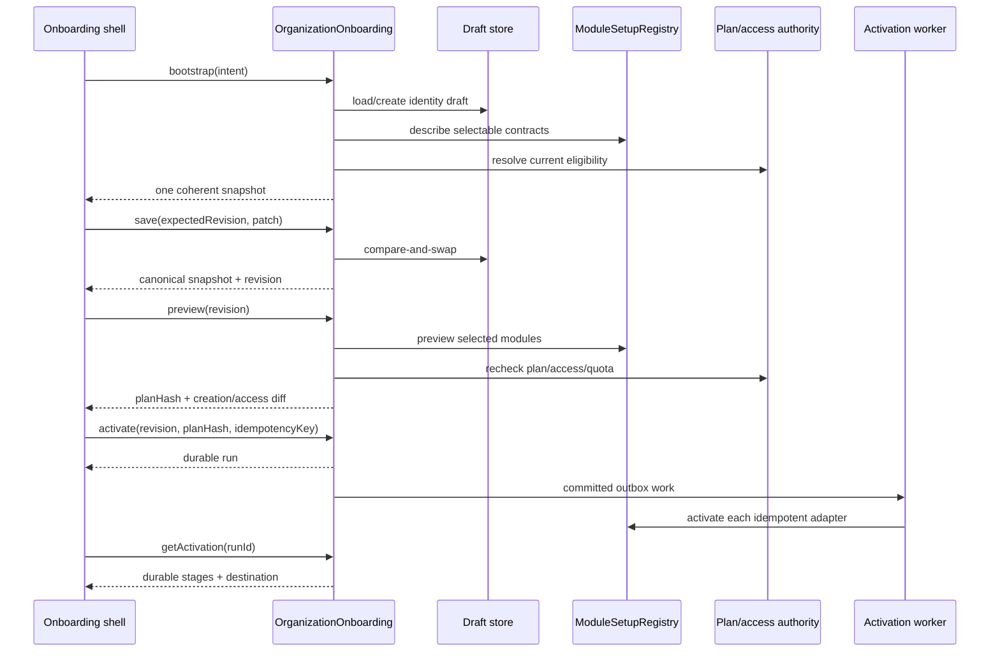

# Fast onboarding implementation plan and acceptance map

Status: Proposed implementation plan, 2026-10-12. No work package is complete until its evidence gate is recorded.

Product contract: [Fast, adaptive, voice-assisted onboarding](./02-fast-adaptive-voice-onboarding-prd.md).

## 1. Architecture shape

The onboarding shell is a deep module. Callers learn one small interface while draft migration, question selection, preview consistency, activation orchestration, caching, and provider failure handling stay inside its implementation.

```ts
interface OrganizationOnboarding {
  bootstrap(actor: SetupActor, intent: SetupIntent): Promise<SetupSnapshot>;
  save(actor: SetupActor, command: SaveSetupDraft): Promise<SetupSnapshot>;
  preview(actor: SetupActor, command: PreviewSetup): Promise<SetupPreview>;
  proposeFromVoice(actor: SetupActor, audio: BoundedAudio): Promise<VoiceProposal>;
  activate(actor: SetupActor, command: ActivateSetup): Promise<ActivationRun>;
  getActivation(actor: SetupActor, runId: string): Promise<ActivationRun>;
}
```

The interface includes these invariants: the actor owns or is authorized for the setup target; every mutation uses an expected revision or idempotency key; preview identifies its draft and policy versions; voice returns a proposal and never mutates; activation accepts only a fresh, acknowledged preview; and activation results expose durable server state.

`ModuleSetupRegistry` is the internal seam that varies by selected module. One adapter per selectable module provides a versioned contract and delegates final writes to the module's existing command owner. The HTTP controller, React shell, voice parser, and activation worker cannot import module repositories or duplicate module validation. Universal and platform-admin entries in the central module registry never become selectable adapters.

```ts
interface ModuleOnboardingAdapter {
  describe(context: ModuleSetupContext): Promise<ModuleSetupContract>;
  preview(context: ModulePreviewContext): Promise<ModulePreviewContribution>;
  activate(context: ModuleActivationContext): Promise<ModuleActivationResult>;
}
```

This interface intentionally has three operations. Validation and question selection are part of `describe`; activation planning is part of `preview`; retry and compensation are implementation details behind idempotent `activate`. The registry rejects duplicate keys, unsupported contract versions, and selectable modules without adapters at startup or CI.

## 2. Selectable module acceptance map

The current organization setup contract accepts 12 module keys. Chat and Knowledge are universal capabilities and appear in the preview as included. The remaining ten are selectable products and need explicit adapters.

| Module | First blocking question | Safe launch result | Deferred setup | Primary destination |
|---|---|---|---|---|
| Build | Work type | Versioned starter project and workflow; optional sample ticket | integrations, releases, advanced statuses, client portal | `/build/command-center` |
| CRM | None; infer a reversible starter pipeline | Empty named starter pipeline, no fake contacts or deals | import, email connection, enrichment, automation | `/crm` |
| Accounting | Confirm country and base currency only when absent/conflicting | Module enabled with compliance checklist; no invoice, ledger, tax, or opening balance | legal profile, tax, bank, fiscal controls | `/accounting` |
| Inventory | None | Empty default warehouse only after customer confirms its name in Customize; otherwise checklist | products, valuation, taxes, reorder rules | `/inventory` |
| HR | None | Module enabled with employee-import checklist; owner is not silently made an employee | policies, leave, employee records, compliance | `/hr` |
| Payroll | Pay frequency only when Payroll is the primary module | Module enabled with blocked-until-configured state; no pay run | legal entity, employee mapping, bank, tax | `/payroll` |
| Timesheets | Approval mode | Reversible approval policy and empty tracking setup | rates, payroll mapping, lock policy | `/timesheets` |
| Support | Primary support channel | Empty queue and starter SLA draft; no public channel until confirmed | email/domain connection, hours, escalation | `/support` |
| Surveys | Audience | Draft starter survey/template, never sent | branding, recipients, schedule | `/surveys` |
| Sign | Document category only when Sign is primary | Module enabled with template-upload checklist; no legal document | identity, template, signers, retention | `/sign` |
| Knowledge | No selection or blocking question | Included universal surface and optional starter space | import and structure | `/knowledge` |
| Chat | No selection or blocking question | Included universal surface; create only the canonical default channel if existing Chat policy does so | channels and integrations | `/chat` |

No module may add more than one candidate blocking question. The onboarding policy selects at most two across the complete module set, prioritizing legal/financial correctness, cross-module dependencies, and the primary module. All other questions become defaults, Customize controls, or checklist items. Each row needs module-owner approval before its adapter is marked launchable.

## 3. Target request flow



## 4. Data and endpoint reconciliation

Do not create a second onboarding stack. Reconcile current source in this order:

| Current source | Required change |
|---|---|
| `org_setup_drafts` and `OrgSetupDraftService` | Return the new revision from save; store strict schema version/current step; enforce expiry bounds; add safe conflict detail; migrate opaque drafts |
| `GET/PUT /org/setup/draft` | Fold into the bootstrap/save interface or version them compatibly; make the frontend use them as durable authority |
| `GET /org/setup/session` | Remove overlapping draft responsibility after migration; retain only compatibility/status behavior with one declared owner |
| `POST /org/setup/selection/preview` | Add contract/policy versions, dependencies, quota semantics, stable reason codes, draft revision, expiry, and plan hash |
| `org_setup_activation_runs` and `POST /org/setup/activate` | Bind run to draft revision and plan hash; return the existing run on replay; expose deterministic stages and final destination |
| `POST /org/setup/complete` | Deprecate after all clients use activation; do not maintain two organization-creation command owners |
| `frontend/app/org-setup/page.tsx` | Reduce to route composition; move orchestration into the feature module; bootstrap before rendering a step |
| local draft utilities | Keep only a bounded recovery mirror; server acknowledgement controls `Saved` and navigation |

Before schema edits, verify the checked-in migrations that created the current draft and activation tables. Additive migrations need a disposable database apply/rollback proof and RLS/catalog assertions. Query indexes follow measured bootstrap, revision-save, and run-status query plans.

## 5. Work packages

### ONB-01 — Contract and current-state lock

Owner: Platform + frontend. Define strict request/response schemas, canonical state machine, compatibility plan, and analytics vocabulary. Capture current network request count, p50/p95 latency, step completion, refresh behavior, and database query plans. Acceptance: generated frontend/backend contracts agree; state transition table covers new owner, existing user creating another organization, invitee, expired draft, and active run; no code path is incorrectly labeled verified.

### ONB-02 — Server draft authority

Owner: Platform/Identity. Evolve the current draft implementation, optimistic concurrency, expiry, migration, cleanup, and account-switch isolation. Acceptance: acknowledged changes survive refresh and another device; two-tab overlap never silently overwrites; stale schema gets review/migration; unauthenticated and wrong-identity access fails; local storage cannot grant module access.

### ONB-03 — Module registry and adapters

Owner: Platform plus every module owner. Implement registry validation and all ten selectable adapters; model Chat/Knowledge as universal preview contributions. Acceptance: CI fails for a selectable module without an adapter; each adapter has describe/preview/activation contract tests; every activation calls its module command owner and is idempotent; question budget is enforced globally.

### ONB-04 — Two-screen shell and preview

Owner: frontend + Design. Remove Welcome and the mandatory People screen; implement Workspace and Configure & preview, responsive preview, Customize, invite panel, save states, conflicts, accessibility, and history behavior. Acceptance: Build-only path has no more than five visible required inputs; multi-module path has at most two blocking module questions; refresh never flashes the wrong step; 375/768/1280 browser evidence covers keyboard, screen reader status, reduced motion, slow network, and errors.

### ONB-05 — Preview, plan, access, and cache

Owner: Billing/Access + Platform. Produce one deterministic preview with selected/included/locked/dependent modules, creation plan, invitation grants, quotas, prices/trial effects, policy versions, expiry, and hash. Acceptance: preview and activation use the same authorities; stale plan or role changes fail closed with an actionable diff; private cache keys include actor/target/draft/policy/contract versions; invalidation tests cover plan, role, module, and draft changes; request count and latency targets are measured.

### ONB-06 — Activation coordinator

Owner: Platform + module owners. Bind organization/membership/entitlement/outbox creation atomically, then execute idempotent module stages. Acceptance: double submit and response loss produce one organization/run; worker crash/replay creates no duplicate starter records or invitations; required/optional failure states are honest; retry touches failed stages only; server selects the destination.

### ONB-07 — Voice proposal

Owner: AI + Platform + frontend. Add pre-organization voice capability, short audio transcription, schema-constrained parsing, review/apply UI, privacy deletion, rate and cost limits. Acceptance: absence of OpenAI configuration, denied microphone, timeout, malformed output, ambiguity, silence, unsupported MIME, oversized audio, and rate limit all preserve a complete text path and draft; raw audio/transcript is absent from durable stores by default; voice cannot save or activate without explicit Apply/Launch.

### ONB-08 — Release proof and rollout

Owner: QA/Release + Observability. Run module matrix, combinations, negative access, disposable database, worker replay, browser, performance, privacy, and deployment checks. Start with internal accounts, then a small flagged cohort, then expand based on error and completion metrics. Acceptance: rollback/kill switches are tested; dashboards separate voice/text and module cohorts; named deployment evidence meets error/latency/resume targets; legacy completion route removal waits until traffic is zero for the agreed window.

## 6. API efficiency and cache budget

The normal text journey targets these logical calls: one bootstrap, coalesced draft saves, one latest preview per stable revision, one activation, and bounded status polling or push. Selecting three modules must not cause three client fetch cascades. The server may parallelize independent adapter descriptions/previews with deadlines and return a bounded per-module unavailable result. Cancel superseded preview requests and ignore late responses by revision/request ID.

Do not cache user drafts, permission truth, activation truth, or accepted commercial state in a shared cache. Cache immutable public contract/template descriptors by version. A private short-lived eligibility projection is allowed only with complete actor/target/revision keys and invalidation. Measure hit rate, stale refusal rate, database time, provider time, and serialized payload size; remove caches that add invalidation risk without measured benefit.

## 7. Minimum test matrix

| Axis | Required cases |
|---|---|
| Identity | new owner, existing owner creating another org, invitee redirect, account switch, expired session |
| Module selection | every selectable module alone; Build+CRM; Build+Timesheets; CRM+Support; HR+Payroll; Accounting+Inventory; all selectable modules |
| Plan/access | available, locked, quota full, plan changes after preview, role revoked, wrong target org |
| Persistence | refresh at each screen, browser back/forward, second device, offline save, two tabs with disjoint and overlapping edits |
| Activation | double click, timeout after commit, worker crash each stage, optional failure, required failure, retry, replay |
| Voice | configured/unconfigured, permission denied, silence, ambiguous fields, accent, provider 429/5xx/timeout, edit before Apply |
| UX | 375/768/1280, keyboard only, screen reader announcements, reduced motion, long localization, slow network |
| Security/privacy | cross-identity draft/run reads, payload bounds, rate limits, PII redaction, raw audio/transcript non-retention |

## 8. Definition of done

The redesigned onboarding is complete only when the two-screen journey, all ten selectable module adapters, universal-capability preview, exact resume, authoritative preview, idempotent activation, optional voice fallback, and post-launch destinations pass the evidence gates on a named deployment. Local source, mocked tests, or a successful WebSocket/provider connection are supporting evidence only. Record the revision, environment, browser/device matrix, database migration state, performance percentiles, failed/retried activation evidence, and remaining exceptions in the release ledger.
