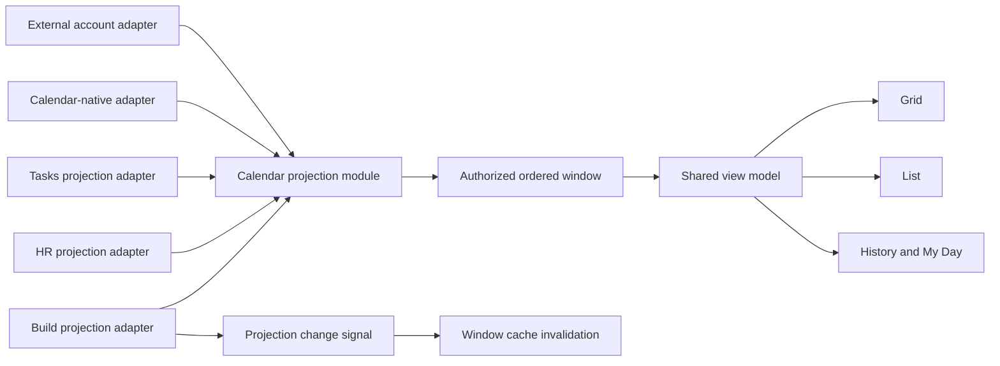
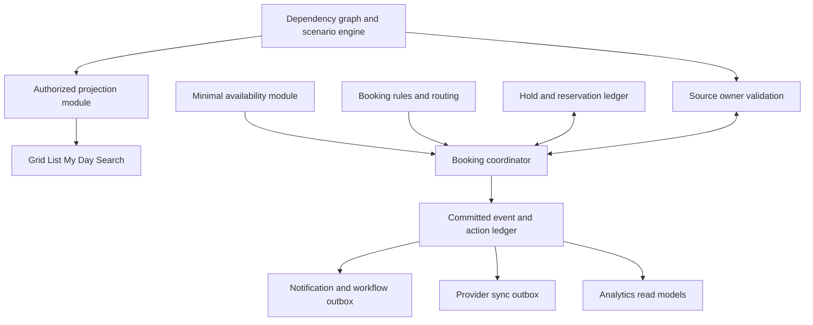

# Calendar projection architecture — decision record and migration plan

**Status:** Proposed design; no application code changed. **Date:** 2026-10-12. **Inputs:** [Product PRD](./product-prd.md), [competitor research](./competitor-research.md), source audit. This design captures the recommended choices accepted in the conversation. It is not runtime verification.

## Decisions

1. Grid, List, History, My Day, and future views consume the same authorized projection set. A view may sort, group, or select a date interval but must not silently omit a source that is enabled for that actor.
2. Dense time windows are navigable. Ordering is deterministic; every bounded result reports completeness and a continuation path. A cap is a safety limit, never a claim that all events were returned.
3. A source record has a stable source key and record ID. An occurrence has a stable occurrence ID, distinct from its current start time. Moved or cancelled exceptions retain the occurrence ID.
4. The source owner determines record-level visibility and permitted actions for the current actor. Calendar composes only authorized projections and does not enrich another module's record by bypassing its authorization path.
5. Source-owner mutations signal projection changes. Local client mutations invalidate affected Calendar windows promptly; focus/reconnect or bounded refresh covers changes from elsewhere until a reliable push mechanism exists. Push notifications are hints to refetch, not authority.

These choices preserve the existing ADR 0004 rule that request-scoped authorization facts resolve once per request. A projection loader must use the established actor context rather than building a second authorization snapshot.

## Current friction and evidence

| Concern | Current code | Consequence |
|---|---|---|
| Source toggle | `frontend/hooks/api/calendar.ts:133-146` invalidates sources only; range cache at `:105-119` is stale for two minutes | Enabled/disabled event rows can remain wrong |
| Build edits | `frontend/hooks/api/build/ticket-update-mutation.ts:278-284` uses `ticket-cache-invalidation.ts`, which has no Calendar key | Due dates and statuses can remain stale in an open Calendar |
| View data | `calendar-grid-layer.tsx:47-60` adds supplemental HR; `calendar-view.tsx:351-367` passes native `visibleEvents` to list/history | Same filters produce different records by view; mobile history preview filters future only |
| Source contract | `backend/src/modules/calendar/calendar-event-source.ts` uses `category` plus generic `meta`; aggregate converts to a fixed item shape | Identity, source semantics, action and freshness data are lost or guessed by the UI |
| Dense ranges | Build selects 401 without `ORDER BY`; Tasks loads all then registry slices at 400 | Incomplete and possibly unstable results, with unnecessary read cost |
| Linked Build data | Calendar detail and source loader query ticket summaries using org and ID, without visible Build project predicate in those queries | Potential restricted-title/status disclosure; requires denied-project integration test |

### Recheck findings: current code, not future capability claims

| Priority | Finding and evidence | Consequence and required repair |
|---|---|---|
| P0 | `calendar-occurrence.service.ts:111-143` expands recurring starts only inside the requested window, while non-recurring events use overlap; `calendar-native-event-source.ts:78-101` emits an occurrence moved outside the window without a final overlap check | A multiday recurring occurrence beginning before the window disappears, while a moved-out occurrence appears in the wrong window. Expand candidates far enough for duration and moved-in exceptions, then filter every effective interval by overlap. Preserve nominal identity. |
| P0 | `calendar-conflict.service.ts:165-250` fetches moved-in exceptions but calls only `expandToOccurrences`; unlike the display path it never collects occurrences whose nominal start is outside the proposed slot | A moved recurring meeting can be absent from conflict warnings. Share one tested occurrence-window algorithm between display and conflict modules, with independent privacy projections. The booking commit must still enforce capacity transactionally. |
| P0 | `calendar-conflict.service.ts:226-250` does not inspect the 500-occurrence expansion ceiling (`calendar-occurrence.service.ts:47,113`) | A dense rule can produce an incomplete conflict scan that appears conflict-free. Any incomplete availability scan must return `unknown` or fail closed, never `free`; a future booking commit cannot rely on advisory warnings alone. |
| P1 | `calendar-recurrence.service.ts:164-215` accepts an arbitrary supplied occurrence instant after owner/series checks; `resolveOccurrenceKey` returns the supplied instant if no existing exception matches | A caller may insert a phantom exception that no RRULE occurrence can use, bump the series version, and queue sync. Validate nominal membership, recurrence bounds, cancellation and expected version before insert/update. |
| P1 | `use-attendance-calendar-events.ts:56-97` treats each monthly response as complete and discards query errors; `attendance-read.service.ts:200-227` caps a month at 35 rows | Multiple sessions can hide later attendance or understate a day's hours, silently. Use an authorized bounded per-day aggregate or paged monthly source, and propagate loading/error/completeness. |
| P1 | `calendar-event-source.loader.ts:173-201` selects at most 400 candidate **series** ordered by original start and has no cap+1 exhaustion indicator | Many old open-ended series can crowd out a newer series with an earlier occurrence in the requested window. The resulting projection may appear complete. Select/merge by effective occurrence order with continuation or return explicit incomplete coverage. |
| P1 | `calendar-view.tsx:351-360` uses `CalendarAgendaPreview` for mobile List and History; `calendar-lazy-fallbacks.tsx:21-66` filters future events and renders inert rows | Mobile History cannot show past items; mobile rows cannot open event details, RSVP or editing. Use the interactive list/history surface at mobile widths. |
| P1 | `calendar-view.tsx:164-174,364-367` supplies History only the current selected date plus/minus one month; `calendar-events-panel.tsx:140-144` filters that slice | History is an unlabeled bounded window, not a historical feed. Give it its own descending paged query or explicitly label the bounded period. |
| P1 | Toolbar `calendar-toolbar.tsx:294-302,353-358` labels a local toggle “HR events”; `use-calendar-computed.ts:62-121` applies it only to supplemental HR rows | Aggregate leave, holiday and interview projections remain visible when the user switches HR events off. Filter by canonical source family across all views, or relabel the control to its actual scope until repaired. |
| P1 | `calendar-view.tsx:181-187,224-234` drops connection-list query errors, then defaults to no active accounts | A failed connection-list request hides every external event without a coverage/error indication. Preserve connection query state in the shared coverage model and expose retry. |
| P1 | `use-hr-calendar-events.ts:60,81,84-90` latches a 403 for the component lifetime | Org or permission change may leave supplemental HR disabled until remount. Tie denial to actor/org/scope and reset when scope changes. |
| P2 | `calendar-events-panel.tsx:145-149` filters List by event start within the visible interval | An overnight or multiday event overlapping the selected day/week disappears. Use interval intersection, including date-only semantics. |
| P1 risk | `calendar-linked-crm.ts:35-60` confirms linked deal/lead belongs to the organization, but does not visibly check caller-level CRM object access | Tenant binding is present; object authorization still needs a denied-deal/lead test and an owner-scoped link resolver before showing linked context. Do not treat this as a proven leak without that test. |

These findings are based on current source and existing tests. The moved-out behavior is explicitly acknowledged as a pre-existing question in `calendar-native-source-recurrence.spec.ts:356-375`. The linked-ticket exposure and cross-account provider-ID collision still require focused integration tests before calling them confirmed end-to-end failures.

## Target module and seam



The **Calendar projection module** is deep: its interface answers one question, "which permitted occurrences appear in this time window, and is the answer complete?" It owns composition, stable ordering, duplicate reconciliation, failure/completeness reporting, and cache tags. Source-specific authorization and record mutations remain behind source-owner adapters. Two existing non-native sources (Build and HR) make this a real seam rather than a hypothetical abstraction.

### Proposed conceptual contract

This is a design shape, not a committed TypeScript API. Existing wire fields and deep links need a compatibility migration.

```ts
type ProjectionIdentity = {
  sourceKey: string;       // registered source, e.g. build-tickets
  recordId: string;        // stable owner record identity
  occurrenceId: string;    // stable even when the occurrence moves
};

type CalendarProjection = {
  identity: ProjectionIdentity;
  title: string;           // already safe for this actor
  startsAt: string;
  endsAt: string;
  timeKind: "instant" | "local-date";
  timezone?: string;       // required when an instant is authored in a zone
  availability: "busy" | "free" | "tentative" | "not-applicable";
  status: string;
  ownerRef?: string;       // only if disclosable
  sourceVersion?: string;
  actions: readonly string[]; // capabilities, not authority to execute
  deepLink?: string;       // generated only if the actor may open it
};

type ProjectionWindow = {
  events: readonly CalendarProjection[];
  nextCursor?: string;
  complete: boolean;
  failures: readonly { sourceKey: string; reason: "unavailable" | "failed" }[];
  asOf: string;
};
```

Identity is a tuple; a UI display ID may be derived from it but must not be parsed back into authority. For a non-recurring record, `occurrenceId` can be a stable sentinel. For recurring series, it identifies the originally scheduled instance, not the current start timestamp. The source version supports stale-action rejection; it is not a replacement for the source owner's write validation.

### Authorization and privacy

- The registered source first checks module availability using the request's actor context. Its owner then applies record-level scope before producing any title, metadata, action, link, count, search hit, or export row.
- A caller denied a linked Build project sees no ticket title or status through Calendar detail. The event may remain visible if Calendar independently permits it, but linked content becomes a non-revealing restricted marker.
- Availability uses a separately minimized free/busy projection where allowed. Do not expose restricted titles or infer a record from failure messages, counts, or continuation metadata.
- Every proposed action is reauthorized and version-checked by the source owner at commit. A capability displayed earlier is not a write token.
- External accounts remain actor-owned and must follow connection scope and provider freshness. A failed account appears in `failures`; it does not erase healthy sources.

### Window semantics

- Query a half-open interval `[start, end)` in an explicit display timezone; date-only commitments preserve their local date rather than being converted through UTC midnight.
- Include every occurrence whose **effective interval overlaps** the requested window, not only those whose nominal or modified start falls inside it. Candidate expansion must account for maximum supported duration; moved-in and moved-out exceptions need one common path and final overlap filter. Conflict and display reads must use identical time membership even though they reveal different details.
- Each adapter filters in storage, sorts by `(start, sourceKey, recordId, occurrenceId)`, and applies a bounded limit. The aggregate performs a stable k-way merge and returns an opaque cursor scoped to actor, organization, filters, source set, and ordering version.
- A cursor is invalid if membership, source preferences, or filter scope changes. Re-query from the first window rather than mixing visibility snapshots. If source rows move during pagination, either use a versioned snapshot/watermark or explicitly restart; a naive live keyset merge can otherwise skip or duplicate occurrences.
- `complete=false` and `nextCursor` distinguish more data from a failed source; `failures` names source keys without exposing hidden records. The UI shows partial coverage and can fetch more.
- Duplicate reconciliation requires explicit source identity or a provider mapping, never matching title and time alone.

### Connected-account window completeness

The current external path requests only 100 Google or Outlook events for the entire three-month Calendar range (`external-calendar-events.service.ts:118-134`). Its response has events and errors but no completeness field. The normalizers parse only `items` or `value`, dropping any provider paging metadata. A busy account can therefore appear complete while later events are absent. This is an observed source-level defect; the exact paging arguments and response wrappers exposed by the installed Composio tools still need verification before implementation.

The external-account adapter should return a window result with `events`, `complete`, `nextCursor` where available, `asOf`, and a scoped error. It pages each connection independently for at most 10 provider requests per account and window, requesting 100 rows per page, normalizes every page, and deduplicates by `(connectionId, providerEventId)`. Google follows `nextPageToken`; Outlook replays the opaque `@odata.nextLink` through the authenticated provider proxy. Never use provider event ID alone across accounts. A complete flag is true only when the provider's continuation is exhausted. A request budget reached without exhaustion is partial coverage, even if the last page contains fewer than 100 normalized events, because invalid or cancelled rows may have been removed during normalization. The partial response tells the user to retry or narrow the date range.

The existing mapping lookup reads all historically linked native event IDs for the selected connections (`external-calendar-events.service.ts:58-71`) and deduplicates with a single provider-ID Set (`:84`). Bound the lookup to relevant native records or use an indexed connection-and-provider identity lookup. The provider replica mapping is the authority for native/external duplication; similar title and time are never sufficient. If two connected accounts happen to return the same provider ID, they remain distinct unless an explicit mapping proves they are one event.

The external response schema and frontend query contract need a compatible extension for completeness and partial-account status. The UI must show account-specific partial coverage and offer continuation or a narrower window. A top-level query failure must show a retry state; currently `calendar-view.tsx` reads only `data` from that query and displays only partial-account errors.

**Verification gates:** an account with 101+ valid events; a page containing cancelled/invalid events; two accounts sharing a provider ID; one provider failing after a successful first page; a timeout at the page budget; a mapped native replica in and outside the selected range; switching organizations while a provider response is in flight. Test Google and Outlook independently because their tool paging shapes may differ.

### Cache and change semantics

- Query keys include organization, actor scope, window, timezone, enabled source set, and filters. On organization switch, the prior organization's data must not render while the new query loads.
- Local source toggle immediately invalidates source metadata and aggregate windows. Local Build/HR/Tasks mutations invalidate Calendar windows whose projections may change. Prefer targeted invalidation for known time ranges; use a Calendar prefix only when the prior range is unknown.
- Backend writes outside the current browser publish a lightweight projection-change hint where infrastructure supports it. The hint carries tenant/source/record identity and revision, no private title. Clients refetch after validating current membership and scope.
- Until push is reliable, refetch active windows on focus/reconnect and use a bounded polling fallback when necessary. A stale or offline window displays its age and cannot authorize a booking or source edit.
- Never optimistically invent source-owned state after a write. Reconcile with the authoritative projection and show partial or uncertain outcomes explicitly.

## Migration sequence and acceptance evidence

| Stage | Change | Required evidence |
|---|---|---|
| 0: safety repairs | Invalidate events on source toggle and Build due-date edits; show external query errors; correct mobile history | Focused cache tests and authenticated grid/list/history journey |
| 1: shared view model | Move supplemental HR and external composition above all views; use one filtered set | Same IDs and source coverage in Grid, List, History for a controlled fixture |
| 2: access | Route linked ticket enrichment through Build access; test private project and role changes | Denied-project test across range, detail, search and deep link; no title/status leak |
| 3: bounded loaders | Order Build results, bound Tasks and HR reads, add continuation | More than 400 records return stable, reachable results; no unbounded query |
| 4: typed projection | Add identity, time kind, availability, status, capability and freshness fields behind a versioned response | Contract tests for each registered source, recurrence move, date-only and deleted record |
| 5: distributed freshness | Owner change hints plus focus/reconnect fallback and stale indicator | Two users/tabs; source update becomes visible within stated freshness target, including reconnect |

The current endpoint may serve old and new projection fields during migration. Remove generic `meta` interpretation only after all source adapters and consumers use the new contract. Preserve explicit truncation/error signals throughout.

The history feed is a distinct query shape: descending past occurrences with its own cursor, permission scope and coverage state. It may reuse the projection contract but must not pretend the currently selected three-month grid window is all history. A per-view source toggle must act on canonical source identity for every feed, rather than a supplemental frontend-only path.

## Edge-case checks

1. A moved recurring occurrence retains identity while its time changes; a cancelled occurrence is not resurrected by a cached page.
2. A user's Build project access is revoked between page one and page two; page-two cursor cannot reuse the prior authorization snapshot.
3. A source is disabled while its old range is cached; all views hide it immediately and refetch without showing stale rows.
4. A ticket moves from one date window to another; both old and new windows are invalidated.
5. A date-only Finance obligation appears on the intended local date through DST and timezone changes without blocking availability by default.
6. One source times out while others succeed; partial coverage is visible and retry does not duplicate records.
7. An external provider and Calendar-native replica refer to the same event; deduplication uses the provider mapping, while provider failure remains visible.
8. Source preference, account filter, and saved view are scoped to the correct organization and actor.
9. A direct link to a now-restricted record reveals no title in response, notification, export, or stale client cache.
10. A dense tenant can navigate to every authorized item without relying on unstable database order.

## Open implementation evidence

The design has not been implemented or validated against a live account. Before coding, verify the exact Build authorization entry point, current notification transport, provider replica mapping, and response-schema compatibility. Those are code facts to inspect, not product decisions to ask the user to make.

## Architecture for later PRD capabilities

The following modules are proposed seams for the PRD's P1–P3 features. Their presence here is a design target, not a claim that booking, holds, resources, routing, payment, simulation, or AI actions exist today. Do not turn the current event aggregate into the authority for those writes.



### Availability, booking, and resources (F-04, F-06, F-14–F-15, F-21–F-23, F-28; W-02, W-07–W-08)

**Availability is a separate minimal module.** It returns candidate-slot constraints and safe reason codes, not event titles or a filtered copy of the display calendar. Its inputs include working hours, timezone, buffers, approved leave, provider freshness, host eligibility, room/equipment capacity, and active holds. A source that cannot be checked is `unknown`, never silently `free`. Public explanations are less specific than authorized host/admin diagnostics.

The current `CalendarService.createEvent` calls `CalendarConflictService` for the creator's own calendar, computes attendee out-of-office separately, and still inserts the event before returning conflict notices (`calendar.service.ts:56-177`). This is an advisory event-creation flow, not the PRD's pre-commit person/resource booking guarantee. The future availability module must check every required attendee and constrained resource; the booking coordinator must reject or explicitly override conflicts before confirmation. It must never infer free time from a truncated recurrence scan or a disconnected provider.

**Booking is one commit coordinator.** It accepts a rule version, candidate slot, actor/guest identity or signed link, source reference, selected hosts/resources, and an idempotency key. It rechecks authorization, current source versions, provider freshness, slot policy, and capacity inside the commit path. A database-enforced constraint or locked capacity ledger prevents two transactions from confirming the same constrained slot; an application-only precheck is insufficient. The booking result distinguishes `held`, `pending external effect`, `confirmed locally`, `rejected`, `expired`, `cancelled`, and `uncertain` as appropriate. Provider sync success is a separate state, not proof of local booking or vice versa.

**Holds have explicit ownership and expiry.** A hold is scoped to one policy/rule version, candidate slot, eligible resource set and guest/session; it has a finite TTL, fencing/version token, and idempotent release. Poll options may use holds but votes do not imply capacity. Finalization always rechecks the slot and consumes a valid hold or atomically obtains a new reservation. Expired, cancelled, or abandoned holds release capacity, including after worker crash.

**Routing is deterministic at commit.** A versioned routing rule evaluates CRM ownership, team fairness, skill/territory, host status, timezones and resource eligibility. Fairness counters or assignment cursors update transactionally with the booking; retries with the same idempotency key return the same assignment. If the chosen host disconnects or becomes ineligible, a documented fallback is applied, or booking stops with alternatives. Routing diagnostics disclose no restricted HR or customer facts to guests.

**Resources are typed and source-owned.** Rooms may be Calendar-managed; equipment and workforce skills need Inventory/HR owner validation. Capacity may be divisible, location-specific, under maintenance, or subject to approval. Calendar holds a scheduling claim; the owner confirms actual eligibility and later changes. A failed equipment allocation cannot be presented as a fully confirmed booking. Cross-module effects produce per-step receipts and a repair path rather than pretending to share a single atomic database transaction.

**Paid appointments add a reconciliation saga.** Payment authorization, booking reservation, capture, cancellation and refund have separate durable states tied by one idempotency key. A successful charge with a failed booking triggers a visible pending refund/repair path; a booking with uncertain payment remains unconfirmed under the commercial policy. Never retry a payment by generating a new key after a timeout.

### Source actions, scenarios, and flexible planning (F-08; W-01, W-03–W-06, W-09)

Calendar projections are read models. An action such as moving a Build due date is a **proposal** until Build validates the actor, object, workflow and expected version. Calendar-native work blocks may be moved directly under Calendar rules; source-owned dates cannot be rewritten by an AI planner or drag gesture without owner validation and user confirmation. A proposed multi-record plan carries per-source version, effect preview, expiration and actor scope. Applying it yields committed/failed/declined receipts for each step; there is no blanket cross-module rollback promise.

The dependency graph for Commitment Radar and chain view stores explicit typed edges with owner and evidence, not inferred title similarity. It detects cycles, missing/deleted nodes, stale versions and hidden nodes. Risk output has `healthy`, `at risk`, and `unknown` with coverage; denied or stale inputs cannot produce a green score. A what-if scenario reads one versioned graph snapshot, makes zero writes during preview, and expires when any affected version or permission changes. Applying selected changes goes through each owner and shows partial outcomes.

The flexible planner schedules only authorized movable blocks within configured work hours, breaks, locked blocks, priority and daily-load limits. It needs a move budget/hysteresis policy to prevent repeated rearrangement after every event. It records why a block moved, the prior slot, and a time-limited undo that rechecks availability and version. It never treats a deadline as a busy block by default.

Meeting preparation and follow-up assemble permission-scoped context at read time. Notes, transcripts, recordings and customer content require their owner permissions and consent/retention policy. Generated follow-ups are drafts; the user reviews each action and receives source-owner commit receipts. A model response is neither an access decision nor proof of a write.

### Automation, developer surface, analytics, and offline access (F-24–F-27; W-10)

Committed changes emit a versioned event through a transactional outbox after local commit. Workflow effects, reminders, provider sync, analytics, and webhooks each consume with a stable event/effect idempotency key. Consumers tolerate duplicate and out-of-order delivery by version checks and reconciliation. Retry budgets, dead-letter state, replay permissions, and operator repair are explicit. A cancelled/rescheduled occurrence must suppress an obsolete reminder at send time.

Developer APIs use tenant-scoped credentials, least-privilege scopes, idempotency keys, pagination and rate limits. Webhooks are signed, timestamped, versioned and replay-protected; their payload is minimized for subscriber authorization. Embeds validate allowed origins and signed state, and callbacks contain only permitted booking facts. Public links are expiring/revocable, rate-limited, non-enumerable, and single-use where configured.

Analytics derives from authoritative lifecycle events rather than counting rendered projections. It defines denominator, timezone, deduplication, partial-source coverage and late-arriving corrections. Small-cohort suppression and role access prevent inference about private HR/Finance activity. Time-quality coaching is an opt-in personal insight, not an employee performance score.

Offline Calendar is an aged read cache with sensitivity policy. It cannot confirm a booking, execute source actions, or assert current availability. Reconnection rechecks actor, tenant, permission, source version, availability and policy before presenting a pending action for confirmation. A revoked member's cached detail must be purged or rendered inaccessible according to the device threat model.

### Cross-cutting failure and edge cases to test before release

| Area | Case | Required result |
|---|---|---|
| Windowing | Source records move across page/window while the user paginates | Stable cursor or snapshot semantics prevent duplicates/missing authorized occurrences; invalid cursor forces restart with an honest notice |
| Provider read | Account returns more than 100 events, malformed rows, partial pages, revoked token, or rate limit | Complete/partial/error remains accurate per account; other accounts stay visible; no infinite page loop |
| Provider identity | Two accounts share one provider ID; a native replica maps to only one | Connection-scoped identity prevents cross-account hiding; only proven replica is suppressed |
| Time | A date-only obligation, overnight event, DST overlap, or moved recurrence crosses a view boundary | Overlap and original occurrence identity are preserved in Grid, List, History, export and reminders |
| Booking race | Two guests target one host, one room, or last equipment unit at once | At most one constrained confirmation; loser receives fresh alternatives; retry returns same result |
| Hold lifecycle | Worker crashes after hold/charge/owner reservation; TTL expires during confirmation | Fencing and reconciliation prevent ghost capacity and duplicate effects; uncertain state is visible |
| Routing | CRM owner, permission, skill, or fairness state changes after slot suggestion | Commit re-evaluates rule/version and explains reassignment or rejection without leaking private reasons |
| Authorization | Membership revoked between availability read, pagination, preview and commit | Every step reauthorizes; stale cursor/preview/action fails closed; cached detail is redacted |
| Scenario | One owner accepts a multi-record plan while another rejects or times out | Per-step receipt and compensating/repair options, with no false all-or-nothing success |
| Automation | Duplicate/out-of-order event, consent withdrawal, destination outage | Current policy and consent rechecked; effects deduplicated and repairable |
| Analytics | Projection duplicated through provider/native paths or source coverage partial | Stable identity deduplicates; denominator and coverage remain explicit |

### Delivery dependency order

1. Complete and authorize projections, external-account pagination, identity, deterministic windows, cache invalidation, and shared views.
2. Establish privacy-safe availability and working-time policy, then durable holds, reservation constraints, and booking lifecycle.
3. Add team routing, polls, resources, public links and provider reconciliation on the booking foundation.
4. Add source-owner action proposals, versioned receipts, dependency graph and flexible planning.
5. Add workflow/webhook ecosystem, analytics, paid booking and advanced simulation only after lifecycle events and coverage are trustworthy.

Each step needs contract tests, real-database races and tenant isolation, authenticated browser journeys, and provider sandbox evidence appropriate to the feature. A source-level implementation alone does not close the PRD release gate.
