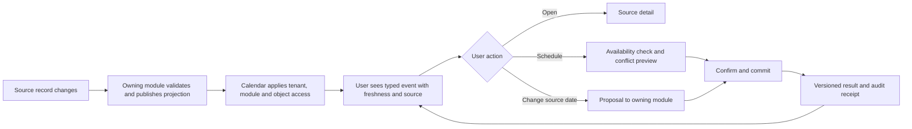
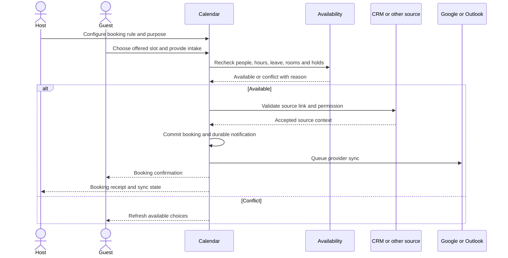
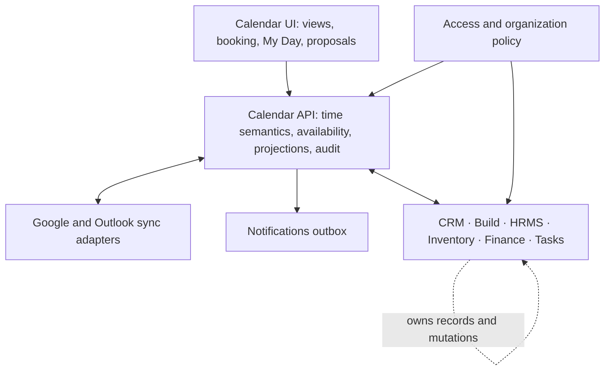
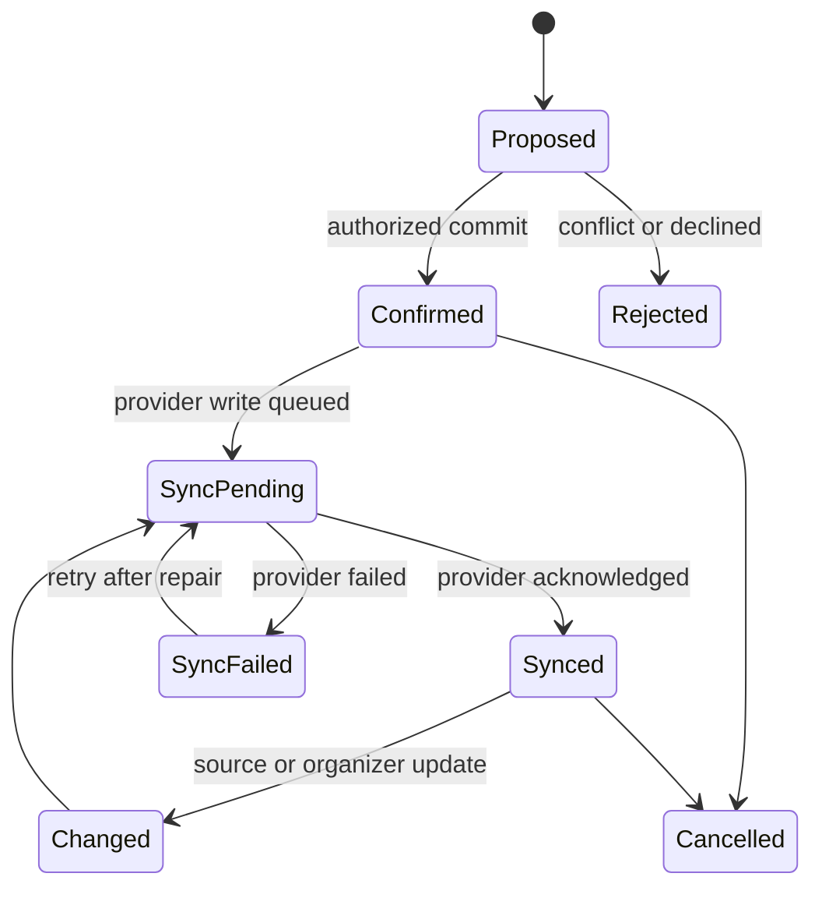
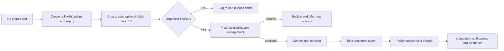

# StreamlineOS Calendar — Product Requirements Draft

**Status:** Proposed for feature review · **Date:** 2026-10-12 · **Owner:** Product / Calendar

This PRD defines the intended product. It does not assert that proposed capabilities are implemented or live-verified. Feature scope should be approved before engineering work begins.

## 1. Product promise

StreamlineOS Calendar is the shared time surface for a business. A person can see the meetings they attend, work they must finish, operations they own, and commitments their organization has made, then take the next permitted action without losing the source context. Calendar explains the consequence of moving time across CRM, Build, HRMS, Inventory, and Finance.

**North-star outcome:** more business commitments completed on time with less manual coordination, without exposing data a viewer is not allowed to see.

**Principle:** Calendar owns scheduling and calendar-native events. CRM, Build, HRMS, Inventory, Finance, and Tasks own their records and business transitions. A calendar projection is a view of a source record, not a second copy of that record.

## 2. Personas and jobs

| Persona | Job in Calendar | Critical constraint |
|---|---|---|
| Individual contributor | Protect work time and deliver assigned work before deadlines | Can change only their own availability and authorized work |
| Sales / account owner | Book customer meetings and honor next-step commitments | Customer context follows CRM permissions and consent |
| Project lead | Align milestones, meetings, and team capacity | Ticket changes follow Build project access and workflow rules |
| People manager / HR | Coordinate interviews, shifts, leave, onboarding, and compliance | Sensitive HR details never leak through titles, search, exports, or free/busy |
| Warehouse / operations lead | Schedule counts, receipts, inspections, and maintenance | Inventory record remains the operational authority |
| Finance operator | Track close, invoice, payment, and renewal work | Money and vendor/customer detail require Finance access |
| Executive | See organizational commitment risk and capacity patterns | Aggregates cannot reveal restricted source records by inference |
| External booker | Select an approved appointment slot | Sees only offered availability and the minimum booking information |

## 3. Current baseline and gaps

Repository and local `/calendar` inspection on 2026-10-12 show a unified calendar UI with day/week/work-week/month/agenda selection, list and history views, source toggles, native event creation, RSVP and recurrence contracts, Google/Outlook account connection flows, sync-status machinery, and calendar projections from selected modules. The production source-registration test explicitly lists native events, Tasks, and HR attendance, holidays, interviews, and leave. Build has a calendar source implementation; the specific live registration and user journey need validation. The UI separately offers HR, attendance, and CRM overlays. Treat these as observed surfaces/contracts, not end-to-end provider or production proof.

| Baseline | What needs product work |
|---|---|
| Several event sources in one view | Shared event meaning, consistent source identity, permission-safe details and actions |
| Native event and recurrence APIs | Fast complete scheduling workflow, conflict resolution, collaboration and resource booking |
| Google / Outlook connection flows | Proven two-way behavior, freshness, divergence recovery, account-level controls |
| Meeting prep and follow-up UI components | End-to-end, source-aware outcome workflow with explicit action receipts |
| Source filters and view modes | Saved role views, cross-source search, workload and capacity lenses |
| Share menu labels in the current toolbar | Verified share actions and permission-safe link/feed behavior; the present menu items have no action handlers in `calendar-toolbar.tsx` |

**Current implementation limits to account for:** The current range contract allows up to 120 days and the aggregate caps a response at 2,000 events, with a 400-event cap per source. The API reports truncation and source failures. A complete product must preserve those honesty signals while providing a way to reach all authorized results in dense tenants. A source or UI entry does not prove that booking, resource reservations, scheduling polls, or cross-module scenario commits exist.

### 3.1 Architecture and edge-case recheck (2026-10-12)

The [Calendar architecture design](./architecture-design.md) records code-level findings, target seams, migration order and negative tests. The most urgent current gaps are incomplete external-account reads (100-event cap without paging status), divergent Grid/List/History and mobile interactions, stale cache after source/Build changes, incomplete native and attendance sources, and recurrence-window/conflict mismatches. Linked Build/CRM object access and cross-account deduplication need focused denied-object and two-account tests before being called confirmed end-to-end exposures. Current conflict notices are advisory after event creation; they are not a booking reservation guarantee.

P0 cannot be considered complete merely because the current Calendar renders or its source tests pass. It needs deterministic coverage, safe actor/object access, recurrence and overlap parity, honest partial states, and authenticated journeys across responsive widths. P1 booking must build on a separate privacy-minimized availability module and transactionally enforced reservations. Later routing, payments, automation, analytics and what-if planning need versioned lifecycle events, owner validation and reconciliation as specified in the architecture design.

## 4. Required foundation

These are release requirements, not optional polish.

| ID | Requirement | Acceptance evidence |
|---|---|---|
| F-01 | Event types: meeting, appointment, deadline, work block, shift, absence, milestone, operational task, financial obligation. Every type declares whether it blocks availability. | An invoice due date and a meeting on the same day render differently; only the meeting blocks booking by default. |
| F-02 | Day, work week, week, month, agenda, list, and history views with keyboard navigation and mobile layouts. | Date/view/filter URL survives reload and back/forward; usable at 375, 768, and 1280 px. |
| F-03 | Create, edit, move, cancel, restore where supported; recurring series and single-occurrence changes; attendee RSVP; reminders; timezone and daylight-saving behavior. | Edits show the intended scope and result, including conflicts and provider failures. |
| F-04 | Availability across permitted internal and connected calendars with working hours, leave, holidays, buffers, resources, and privacy-safe free/busy. | Scheduling never reveals private titles or restricted HR/Finance details. |
| F-05 | Search, source/owner/project/location/status filters, and saved personal/team views. | Counts and search cover the authorized server result, not one rendered page. |
| F-06 | Booking links for one person and teams: intake, routing, round robin, minimum notice, limits, buffers, cancellation and rescheduling. | Concurrent bookings cannot claim the same constrained slot; confirmation and cancellation receipts are durable. |
| F-07 | Google and Outlook connection management: calendar selection, read/write direction, freshness, reauth, conflict and retry states. | A failed sync is visible and never shown as a completed provider write. |
| F-08 | Permission-safe event cards with source, owner, purpose, status, next action, and source deep link. | Direct links, exports, notifications, and search apply the same object and tenant access checks. |
| F-09 | Delegation, resources, meeting rooms, and audit history for authorized teams. | Every change identifies actor, target, scope, previous value, outcome, and timestamp. |
| F-10 | Accessibility, performance, and reliability: bounded range queries, pagination/windowing, error and partial-source states. | One failing source does not make other authorized sources disappear; truncation is explicit. |

### 4.1 Missing foundation found in the second review

The first draft covered the main scheduling path but left several everyday calendar capabilities implicit. They are explicit requirements here; their presence in current code is not assumed.

| ID | Requirement | Acceptance evidence |
|---|---|---|
| F-11 | Invitations: internal/external attendees, optional/required status, organizer ownership, attendee changes, RSVP tracking, and invitation updates/cancellations. | Organizer and attendee see the same current occurrence; removed guests receive cancellation and cannot use an old join link. |
| F-12 | Notification preferences: per-event reminders, default policy, channel, quiet hours, snooze, missed reminder recovery, and cancellation dedupe. | Edited/cancelled occurrences do not send old reminders; one occurrence/recipient gets at most one delivery per policy. |
| F-13 | Interoperability: ICS import/export and subscribe-only feeds where authorized, explicit read-only vs writable calendars, and provider-supported conference links. | Imported events retain timezone/recurrence meaning; private or restricted events are excluded from public/subscribed feeds. |
| F-14 | Booking operations: booking approval where configured, waitlist, temporary slot holds, no-show and attendance status, host substitution, and reschedule/cancel policies. | Expired holds release capacity; no-show does not silently rewrite CRM/HR/Finance facts. |
| F-15 | Resource scheduling: rooms, equipment, capacity, location, maintenance blocks, accessibility needs and approval rules. | Resource and attendee conflicts are checked together at commit time. |
| F-16 | Delegation and shared calendars: ownership transfer, assistant/delegate rights, team calendar visibility, and offboarding handover. | Suspended/departed owner cannot create or modify events; future bookings route to an active owner without data leakage. |
| F-17 | Event content: agenda, notes, files/links, video link, location, and source attachments with safe sharing defaults. | An external guest gets only explicitly shared content; source-owned files preserve source access. |
| F-18 | Navigation and discovery: jump to date, go to event, accessible print/export, saved views, and deep links that survive reload. | The same authorized event opens from search, reminder, source record and direct URL. |
| F-19 | Locality and preferences: first day of week, 12/24-hour clock, locale, display timezone, holidays by location, and working location. | Changing display preference never changes the stored instant or date-only obligation. |
| F-20 | Administrative controls: booking domains, public-link expiry/revocation, spam controls, retention, export policy, provider scope, and automation limits. | Admin can revoke a booking link and inspect audit evidence; existing bookings remain governed by cancellation policy. |

### 4.2 Competitor-parity requirements from primary-source review

The [competitor research](./competitor-research.md) compares official Google, Microsoft, Calendly, Cal.com, Reclaim, Motion, Notion, ClickUp, HubSpot and Salesforce sources. The following gaps should be in the product contract even where they launch after P0.

| ID | Requirement | Acceptance evidence |
|---|---|---|
| F-21 | Scheduling polls: propose multiple times, collect internal/external votes, optionally hold slots, close/expire the poll, recheck and finalize one event. | A stale or fully declined poll cannot issue a booking; expired holds release capacity and all voters receive the final outcome. |
| F-22 | Team routing: collective/all-host, weighted/fair round robin, CRM owner continuity, territory, skill, language and resource matching, with auditable fallback. | Routing explains the selected host; disconnected or unavailable hosts are excluded unless an explicitly safe policy says otherwise. |
| F-23 | Customer-facing booking: branded and embeddable pages, localized intake, single-use/expiring links, optional paid appointments/deposits/refunds and conversion attribution. | Link expiry and payment outcome are enforced server-side; failed/uncertain payment cannot be presented as a confirmed paid booking. |
| F-24 | Workflow automation: triggers for creation, reschedule, cancellation, no-show, start/end and source state; conditions, consent, dry run, retries, limits and audit. | A repeated trigger delivers each configured effect at most once; failure is visible and repairable without duplicating messages. |
| F-25 | Developer surface: scoped scheduling APIs, signed/versioned webhooks, embed callbacks, tenant credentials, rate limits, replay, deletion and compatibility policy. | Invalid signature, wrong tenant, stale version and excess rate fail closed; deliveries can be replayed safely. |
| F-26 | Mobile and connectivity contract: full responsive primary journeys, explicit future native-client scope, read-only offline cache with age label and safe reconnection. | Offline or stale data cannot confirm a booking or source edit; queued actions require an online recheck before commit. |
| F-27 | Booking and time analytics: funnel, routing outcome, no-show, utilization, schedule churn, meeting load, focus protection and source-linked commitments. | Definitions, denominator, coverage and privacy threshold are visible; small groups cannot reveal a person's private calendar. |
| F-28 | Availability diagnostics: explain blocked slots by policy, busy/free, leave, buffer, capacity, fairness and provider freshness without revealing restricted detail. | Host/admin can diagnose a rejected slot; guest sees a safe generic reason and alternatives. |

## 5. Cross-module contract

| Source owner | Events contributed | Calendar action | Record owner validates |
|---|---|---|---|
| CRM | Customer meeting, promised follow-up, renewal date | Book / open / propose follow-up | Contact/deal access, consent, stage and next-step rules |
| Build | Ticket due date, milestone, release, project meeting | Open / reserve work block / propose date change | Project membership, ticket visibility, workflow and version |
| HRMS | Leave, holiday, shift, interview, onboarding, compliance | View permitted detail / book interview / open request | Role, manager scope, privacy, approval state |
| Inventory | Count, receipt, inspection, maintenance, expiry | Assign slot / open operation / propose reschedule | Warehouse scope, resource constraints, operation status |
| Finance | Close, invoice, payment, renewal, approval | Open obligation / schedule review | Financial permissions, entity scope, posting/approval rules |
| Tasks | Due date and scheduled work | Reserve work time / open task | Assignment, status, priority, version |

**Projection policy:** A source provides stable source key, record ID, occurrence ID if recurring, time semantics, display-safe summary, visibility class, owner, status, actions, source version, and freshness. Calendar applies module availability and source-specific object access before projection. A hidden source is not evidence that no commitment exists; risk calculations must also be authorized and disclose their coverage.

### 5.1 Domain vocabulary and ownership

| Concept | Meaning | Authority |
|---|---|---|
| Source commitment | A due date or milestone attached to a business record | Owning module |
| Calendar-native event | A meeting, appointment, personal event or work block created in Calendar | Calendar |
| Occurrence | One instance of a recurring series, including moved/cancelled exceptions | Series owner and stable occurrence identity |
| Availability constraint | Free/busy, working hours, approved absence, resource capacity or protected block | Originating provider/module; Calendar composes it |
| Booking rule | Who may book what, when, with whom, and under which policy | Calendar, configured by authorized owner/admin |
| Slot hold/reservation | Temporary claim and committed allocation for people/resources | Calendar transaction plus resource owner validation |
| Proposal | Preview of a possible schedule or source-record change | Calendar; no mutation before confirmation |
| Action receipt | Per-step committed/failed/declined result with source reference | Actual mutating owner |
| Provider replica | External Google/Outlook representation and sync state | Provider owns remote truth; Calendar owns local reconciliation |

Stable IDs, source versions and typed ownership are prerequisites for deduplication, risk calculation, scenario preview and undo. Similar titles or timestamps are insufficient to merge records.

## 6. Ten wow features

Each feature has a distinct user outcome. An AI suggestion is a proposal until a human confirms any write.

| ID | Feature | User-visible flow | First acceptance criterion |
|---|---|---|---|
| W-01 | **Commitment Radar** | “What is likely to slip?” shows a release, customer promise, inventory receipt, or close obligation with its time conflict and source evidence. | Risk reason names permitted inputs, owner, deadline and freshness; restricted input remains hidden. |
| W-02 | **Explainable best-time finder** | User selects participants and purpose; the assistant ranks slots using hours, leave, room, buffers, travel and priority, with reasons. | Suggestions show constraints and alternatives; booking rechecks availability atomically. |
| W-03 | **What-if calendar** | Drag a milestone or meeting into a preview; see downstream schedule, people, customer and resource impacts before applying. | Preview makes zero writes; applying shows a per-record confirmation and partial-result receipt. |
| W-04 | **Meeting-to-outcome workspace** | Open a meeting to see permitted CRM, Build, document and prior-decision context; review proposed decisions and follow-ups afterward. | Every follow-up has source linkage, owner, confirmation and a visible committed/failed state. |
| W-05 | **Adaptive work-time planner** | Set task estimates and protected hours; receive movable blocks ahead of deadlines as meetings and priorities change. | User-locked blocks stay fixed; automatic moves are explained and reversible. |
| W-06 | **Role-aware My Day** | One agenda blends meetings, shifts, due work, approvals and preparation, ordered for the person's role. | Every item identifies its source and action; disabled or denied modules expose no record data. |
| W-07 | **Customer journey scheduler** | A booking link routes a prospect or customer to an appropriate owner and brings permitted account context into the meeting. | Routing follows published rules, timezone, ownership and consent; no double booking. |
| W-08 | **Operational capacity map** | Team lead sees warehouse counts, inspections, staff shifts, rooms and equipment against actual capacity. | Over-capacity is explained by specific permitted constraints; tentative plans never imply stock or staffing confirmation. |
| W-09 | **Cross-module chain view** | A date opens the chain “deal promise → Build milestone → inventory delivery → invoice” with dependencies and accountable owners. | Each link opens the source record; unauthorized nodes use a non-revealing placeholder. |
| W-10 | **Time-quality coach** | Weekly review highlights meeting load, focus time, missed commitments and repeated reschedules, then proposes concrete changes. | Metrics show their source coverage and definitions; no employee performance score or automated HR decision. |

### 6.1 Wow-feature guardrails and edge behavior

| Feature | Additional requirement before release |
|---|---|
| W-01 Commitment Radar | Distinguish `at risk`, `unknown`, and `healthy`; missing source data, stale sync, or permission-limited coverage cannot become a green score. Show deadline provenance and who can act. |
| W-02 Best-time finder | Explain when no slot exists, support optional attendees and alternate durations, avoid exposing whose private event blocks a slot, and revalidate after a suggestion ages. |
| W-03 What-if calendar | Model dependency confidence and circular/missing links; show a before/after diff and all affected owners. Preview expires when any source version changes. |
| W-04 Meeting-to-outcome | Notes, recording/transcript and AI context require explicit availability and consent. Do not infer a decision from a transcript; the user reviews each proposed action. |
| W-05 Work-time planner | Respect locked blocks, breaks, leave, nonworking days and maximum daily load. Avoid thrashing blocks after every incoming event; show a move history and undo. |
| W-06 My Day | Distinguish actionable items from FYI dates; reconcile duplicates when one source record appears through several feeds; explain incomplete source coverage. |
| W-07 Customer scheduler | Defend public links from enumeration/spam, use minimal intake, handle anonymous cancellation securely, and avoid assigning an inactive owner. |
| W-08 Capacity map | Support partial-day shifts, skill/equipment constraints and maintenance windows. Never present a reservation as confirmed until every owning resource accepts it. |
| W-09 Chain view | Require explicit or well-evidenced dependency links. Do not invent a link based only on similar names; cycles and broken references get visible diagnostics. |
| W-10 Time-quality coach | Use organization-approved metrics and opt-in individual insights. State data coverage, exclude private event details, and never turn the output into an employment ranking. |

W-02 includes polling/negotiation from F-21 when no immediate common slot exists. W-07 uses F-22 routing and F-23 distribution. W-10 uses the privacy-safe measurement definitions in F-27. These dependencies deepen the existing wow features; they do not create three more marketing names for the same behavior.

### Prioritization

| Phase | Capability | Reason |
|---|---|---|
| P0 — trustworthy core | F-01–F-05, F-07–F-08, F-10–F-12, F-18–F-20, F-26 responsive/online safety; source contract and access gates | Every subsequent feature depends on correct meaning, invitations, access, notification policy and freshness. |
| P1 — useful scheduling | F-06, F-09, F-13–F-17, F-21–F-22, F-23 branded/embedded/single-use links, F-27 basic booking funnel, F-28, W-02, W-04, W-06, W-07 | Delivers booking, collaboration, interoperability, daily planning and meeting outcomes. |
| P2 — business advantage | F-23 optional payments, F-24–F-25, F-26 offline, F-27 full analytics, W-01, W-05, W-08, W-09 | Adds commercial booking, safe automation/developer access and cross-module risk prevention. |
| P3 — simulation and coaching | W-03, W-10 | Needs proven dependency quality and understandable metrics. |

Each phase is a dependency order, not a promise that every feature ships together. P0 requires real provider and browser proof for the paths it exposes; an unverified connection must retain an explicit status.

## 7. Experience diagrams

### 7.1 From a business commitment to an action

### 7.2 Scheduling and booking journey

### 7.3 Ownership and data flow

### 7.4 Event and action state

The state diagram describes a calendar-native booking/write. Source-owned deadlines retain their owning module's workflow state; Calendar only reflects it.

### 7.5 Negotiation, routing and automation

Polls and routing never reserve a slot permanently before the final commit. An automation or webhook receives a versioned committed event, not a suggestion, expired hold or unconfirmed provider write.

## 8. Detailed rules

1. **Time semantics:** Store an instant plus IANA timezone for timed events; store date-only values for all-day/deadline items. Display timezone explicitly when participants differ. Recurring occurrences have stable identities; daylight-saving gaps and overlaps receive deterministic handling.
2. **Availability:** Only meetings, appointments, approved absence, shifts where appropriate, and explicit work blocks affect free/busy. Deadlines and informational milestones do not block time by default. A tentative or stale source cannot be silently treated as confirmed availability.
3. **Conflict policy:** Detect person, room, equipment, working-hour, leave, provider and source-version conflicts. Explain each conflict and allow an authorized override only where the owner permits it.
4. **Privacy:** Event title, description, attendees, financial values, HR details, search text, notifications, exports, analytics and AI context all obey the same effective access. Free/busy is a separate minimal view.
5. **Writes:** Calendar-native edits use version checks and idempotency keys. Source-owned edits invoke the owner service. A multi-record plan reports each committed, failed or declined step; it never claims atomic success across modules or providers.
6. **Reliability:** Source and provider reads show last successful sync, failures, truncation and stale data. Queue external writes and notifications through durable jobs/outbox; retries must not duplicate invitations or reminders.
7. **Control:** Scheduling suggestions, AI summaries and risk signals include evidence links and coverage. Users review proposed changes. Organization admins can configure enabled sources, booking policy, retention and automation boundaries.

### 8.1 Interoperability and accessibility standards

- ICS import/export and recurrence must preserve iCalendar event identity, exceptions, timezone and attendee semantics defined by [RFC 5545](https://www.rfc-editor.org/info/rfc5545/). Invitation request/reply/cancel behavior should be tested against [RFC 5546 iTIP](https://www.rfc-editor.org/info/rfc5546/) where the chosen provider transport uses it.
- Provider synchronization must handle paginated incremental changes, deleted entries and invalid sync tokens; Google explicitly specifies a full resync after a `410` invalid token. Provider push notifications signal that something changed and require fetching the actual changes. See [Google incremental sync](https://developers.google.com/workspace/calendar/api/guides/sync) and [push notifications](https://developers.google.com/workspace/calendar/api/guides/push).
- Calendar grids, drag alternatives, dialogs, booking forms, status messages and error recovery target [WCAG 2.2 AA](https://www.w3.org/TR/WCAG22/). Passing automated checks alone does not establish keyboard or screen-reader usability.

## 9. Acceptance journeys

| ID | Journey | Evidence needed to close |
|---|---|---|
| A-01 | Employee with HR leave and two connected accounts books a meeting across time zones. | Browser flow, provider acknowledgment, no overlap, correct DST rendering. |
| A-02 | Sales owner books from a deal; guest reschedules; CRM follow-up is proposed. | Customer receives one valid booking; CRM link and follow-up receipt are correct. |
| A-03 | Project lead moves a Build milestone in scenario mode, then approves selected changes. | Preview made no writes; each approved source change has versioned receipt; failures remain visible. |
| A-04 | Warehouse lead schedules a count that competes for a worker and scanner. | Capacity conflict appears before commit; source owner validates assignment. |
| A-05 | Finance deadline appears to an authorized operator and a restricted colleague. | Operator sees detail; colleague sees no title, amount, search hit, export row or AI disclosure. |
| A-06 | A connected provider disconnects during an edit. | Local state says sync pending/failed, offers repair, and does not claim the provider was updated. |
| A-07 | Recurring event crosses a DST change and one occurrence moves. | Correct wall-clock policy, occurrence identity, reminder cancellation and attendee notification. |
| A-08 | Two guests choose the same final team slot concurrently. | At most one confirmed constrained booking; the other receives fresh alternatives. |
| A-09 | A meeting poll spans external guests and optional attendees; one option becomes unavailable before finalization. | Votes remain visible, expired holds release, and organizer gets fresh choices before one final invitation. |
| A-10 | CRM owner is out, another host has matching territory/skill, and the first host's provider is disconnected. | Routing uses the approved fallback and shows why; disconnected host is not assumed free. |
| A-11 | Customer uses a branded embedded booking page and an expiring single-use link. | Parent page receives only approved callback data; link cannot be reused; conversion is counted once. |
| A-12 | A paid booking succeeds remotely but provider response is lost; guest retries. | Payment and reservation reconcile by idempotency key; no second charge or confirmed duplicate; refund path is auditable. |
| A-13 | Booking is rescheduled twice while a webhook consumer is down. | Signed, versioned events replay in order or reconcile safely; workflow effects and notifications are not duplicated. |
| A-14 | User opens a cached mobile calendar offline and attempts to move a source-owned deadline. | Cache age is shown; no mutation claims success offline; online return rechecks version/access and requests confirmation. |
| A-15 | Executive views booking analytics for a small team with restricted HR and Finance sources. | Aggregates show coverage and suppress small-group inference; no restricted titles or individual schedule data leak. |

### 9.1 Edge-case and failure matrix

These scenarios are part of feature acceptance, not a later hardening backlog.

| Area | Edge case | Required behavior |
|---|---|---|
| Time | DST nonexistent/duplicate local hour; leap day; midnight-crossing event; all-day event; different organizer/attendee zones | Preserve explicit time semantics, reject or disambiguate impossible local input, and display the occurrence correctly in each zone. |
| Time | Date-only invoice/holiday shifts because the viewer changes timezone | Date remains the same business date; it is never converted through midnight UTC. |
| Recurrence | Move/cancel one occurrence, edit this-and-following, series end, duplicate provider exception | Stable occurrence ID; correct future rule and notifications; no resurrected cancelled event. |
| Recurrence | Unbounded/high-frequency rule or expansion across many months | Enforce range and occurrence limits server-side, indicate truncation, and preserve navigation. |
| Invitations | Organizer leaves, attendee is removed, guest changes email, RSVP arrives after cancellation | Recheck identity and event state; obsolete invites and links cannot mutate the live event. |
| Availability | Two bookings race for one slot; resource is held then hold expires | Commit is atomic for each constrained resource; losers receive refreshed alternatives. |
| Availability | External calendar is stale/disconnected or permission to read free/busy is lost | Mark availability uncertain and apply configured fail-closed booking policy; never imply confirmed free time. |
| Availability | Leave is pending/rejected or a shift changes during booking | Use approved/current state, then revalidate at commit; warn rather than expose HR detail. |
| Booking | Guest abandons checkout, repeats submit, uses stale link, or receives delayed confirmation | Holds expire; idempotency avoids duplicates; current link policy is enforced; receipt reflects actual commit. |
| Booking | Host is on leave, offboarded, over daily limit, or round-robin assignment fails | Route to eligible host or offer alternatives; do not assign a suspended member. |
| Booking | Spam or scripted traffic floods a public link | Rate limit, abuse detection, revocation and operational visibility without leaking internal availability. |
| Providers | Provider accepts write but response times out; webhook is duplicated/out of order; OAuth expires | Reconcile by stable external ID/version; retries are idempotent; status stays uncertain until confirmed. |
| Providers | Same event edited locally and externally, or one account appears through multiple sources | Show conflict with versions and owner; deduplicate only proven identities, never by matching title/time alone. |
| Providers | Google/Outlook conference creation fails after booking | Preserve booking with explicit conference-link failure and repair path; avoid a false join button. |
| Security | Actor changes organization, loses permission, or source module is disabled while detail is open | Close/redact stale detail and action UI; server rechecks access on every read and write. |
| Security | Private HR/Finance data leaks through title, color, tooltip, notification, export, AI, analytics or shared free/busy | Redact every derived surface; test direct object access and inference through aggregates. |
| Data | Source record deleted/archived, version changes, or cross-module link becomes invalid | Projection disappears or shows a safe tombstone; action returns a clear conflict; no orphan mutation. |
| Data | One source fails, is slow, or truncates while other sources succeed | Show partial results with source-specific freshness/error and an honest count or truncation indicator. |
| Data | Same commitment appears as native event, task, CRM reminder and provider copy | Group only with stable linkage; retain each owner and action; prevent duplicate alerts. |
| Notifications | Event moves during reminder dispatch or is cancelled after queueing | Recheck occurrence, attendee and policy at send time; cancel/dedupe stale deliveries. |
| UX | Empty calendar, no search matches, denied source, disabled module, offline view, or loading | Distinct accessible states with appropriate next action; denial never looks like an empty success. |
| UX | Drag via mouse is unavailable to keyboard/touch user | Equivalent edit controls, focus restoration, screen-reader announcement and undo. |
| Scale | Large tenant, dense recurrence, many sources/attendees, slow mobile network | Bounded server queries and expansions; progressive rendering; clear partial/timeout states. |
| Polls | Guest votes twice, poll expires, organizer closes early, or a held option becomes busy | Deduplicate votes, release holds, recheck the chosen option and send exactly one final invitation. |
| Routing | Weighted distribution races, CRM owner changes, skill/territory rule has no match | Apply deterministic rule/version at commit; provide safe fallback or no-slot state with audit reason. |
| Payments | Payment succeeds but booking fails, booking succeeds but payment is uncertain, chargeback/refund follows cancellation | Reconcile both ledgers by idempotency key; show pending/failed state; never silently double-charge or mark unpaid as paid. |
| Embeds | Third-party page spoofs callback or changes origin | Validate allowed origin and signed state; expose only minimal booking details. |
| Workflows | Duplicate/out-of-order trigger, consent withdrawn, destination unavailable | Recheck current policy and consent; idempotent effect, durable retry, dead-letter and operator repair. |
| APIs/webhooks | Token revoked, wrong tenant, signature replay, consumer timeout or schema upgrade | Scope and version every request/event; reject replay, retry safely and document compatibility window. |
| Mobile/offline | Cached source detail becomes restricted while device is offline | Label age, hide highly sensitive offline detail by policy, and reauthorize before any online action. |
| Analytics | Small cohort, partial source outage, duplicate projected event | Suppress inference, display coverage and deduplicate using stable IDs; never report a complete denominator from partial data. |
| Recurrence/window | A weekly 23:00–02:00 occurrence starts before the selected day, or an exception moves in/out of a range | Grid, List, History, export and conflict checking use effective interval overlap; the moved occurrence appears once in its new window and never in its old one. |
| Conflict completeness | A dense RRULE reaches the occurrence expansion ceiling, or a source/provider is only partly loaded | Availability becomes `unknown` or rejects commit; a partial scan cannot assert that a slot is free. |
| Recurrence write | Caller names a date not generated by the RRULE, beyond the series end, or already cancelled | Reject without inserting an unusable exception, bumping version or queuing a provider write. |
| Dense native source | More than 400 old open-ended series compete with a newer series in the requested window | Newer authorized occurrences remain reachable in deterministic occurrence order; response states whether more exist. |
| Connected accounts | Google/Outlook returns more than 100 events, an invalid/cancelled row, a rate limit, or failure after page one | Per-account result is paged or explicitly partial; filtered rows never masquerade as end-of-feed. |
| Connected identity | Two accounts return the same provider event ID and only one has a native replica | Account-scoped ID keeps the other event visible; deduplication requires an explicit mapping. |
| Attendance | More than 35 monthly sessions, one monthly request fails, or WFH request fails | Day totals/status are complete or marked partial; an error never renders as an empty successful month. |
| Filters | HR toggle is off while aggregate HR leave/interview/holiday and supplemental HR rows exist | One toggle rule hides the intended source family in every view, or the control names its narrower scope. |
| History/mobile | User opens an old event on a phone, navigates back, or needs an event outside the grid's three-month window | Historical feed pages independently, rows open details/actions, and URL/view state survives navigation and reload. |
| Connection discovery | Connection-list request fails while native Calendar succeeds | Connected-account coverage is unknown and retryable; the UI does not imply zero connected events. |
| Pagination under change | Permission, source preference, or occurrence time changes between pages | Cursor is rejected/restarted or bound to a consistent snapshot; no restricted, duplicated or skipped item is presented as complete. |
| Export | One old high-frequency series fills the row cap before earlier in-window occurrences of other records | Export is occurrence-ordered and either complete or clearly partial with a continuation/retry path. |

### 9.2 Release evidence by feature type

| Capability | Minimum evidence |
|---|---|
| Native scheduling and recurrence | Unit/contract tests plus real-database occurrence, attendee and reminder tests; browser edit/cancel flow. |
| Google/Outlook sync | Real sandbox provider create/update/delete/reconnect flow and duplicate/out-of-order webhook simulation. |
| Source projections | Tenant, object permission, module-disabled, archived/deleted source and truncation tests for each module. |
| Public booking | Concurrency test against real persistence, abuse controls, guest cancellation, host offboarding and email delivery proof. |
| Wow suggestions and AI | Grounded evidence, incomplete-data behavior, permission replay, user confirmation and failed/partial write receipts. |
| Cross-module scenarios | Source-owner validations, version conflict, cyclic dependency and rollback/compensation behavior. |
| Accessibility/performance | Keyboard and screen-reader journeys, 375/768/1280 viewport checks, measured p95 on dense representative data. |
| Polls/routing/payments | Real-persistence races, host fallback, hold expiry, payment timeout/reconciliation and guest receipts. |
| Workflows/developer API | Signature/scope replay, version compatibility, consent revocation, retry/dead-letter and tenant isolation tests. |
| Offline/mobile | Cache age, access revocation, reconnection conflict and online reauthorization in a supported client. |

## 10. Success measures and release gates

**Primary measures:** on-time completion rate for commitments represented in Calendar; median time to schedule a meeting; booking completion rate; proportion of meetings with an accepted next action; avoidable conflict rate. Segment by module, role and organization size. Do not use employee-level scores for performance decisions.

**Reliability measures:** provider sync success and lag, stale-source exposure, duplicate booking/reminder rate, recurrence and timezone incident rate, p95 range-query latency, and permission-denial leakage incidents.

**Release gate:** focused contracts and source isolation tests; real-database tenant/object-scope tests; browser journeys at desktop/tablet/mobile widths; real Google and Outlook sandbox accounts; notification and reconnect scenarios; accessibility keyboard/screen-reader review; operational observability; and product sign-off on the acceptance journeys. Passing source tests alone does not close provider, browser or production proof.

## 11. Decisions to close before implementation

1. **First customer segment:** prioritize a small cross-functional company, a sales-led company, or operations-heavy organization? This decides which P1 booking and module flows lead the release.
2. **External booking policy:** public links only, or also authenticated customer/client portal booking?
3. **Automation authority:** should W-05 move only Calendar-created flexible blocks initially, or also propose changes to source-owned deadlines? Recommended: flexible blocks only; source dates always require owner confirmation.
4. **Commitment Radar scope:** begin with CRM + Build + Tasks, then Inventory + Finance as their source contracts mature? Recommended: yes, with explicit coverage shown.
5. **Meeting context:** which Documents/Mail/Chat sources may be included, under which consent and retention rules?
6. **Availability under uncertainty:** should a stale external calendar block public booking or display a warning with an admin-configured override? Recommended: block public booking until a fresh check succeeds; internal users can propose a time with an explicit warning.
7. **Default event visibility:** which organization roles may view a meeting title, attendee list and linked source detail? Recommended: free/busy only outside participants and explicitly authorized source viewers.
8. **External guest identity:** should guest rescheduling use a signed single-purpose link, authenticated portal identity, or both? Recommended: expiring signed link for ordinary guests and portal identity where available.
9. **Resource launch scope:** rooms first, or rooms plus equipment and workforce skills? Recommended: rooms at P1; equipment and skills enter with Inventory capacity at P2.

## 12. Competitive reference and differentiation

The [primary-source comparison](./competitor-research.md) covers Google Calendar, Outlook/Bookings, Calendly, Cal.com, Reclaim, Motion, Notion Calendar, ClickUp Planner, HubSpot Meetings and Salesforce Scheduler. Features vary by plan, client and region; a documented capability is not proof of universal availability. The table below is the intended **competitive coverage contract**, not an implementation claim.

| Competitive job | Relevant PRD capabilities | StreamlineOS differentiator to validate |
|---|---|---|
| Dependable personal/team calendar | F-01–F-05, F-07–F-13, F-16–F-19, F-26 | Source-owned dates beside meetings with honest free/busy and permissions |
| Customer and team booking | F-06, F-14–F-15, F-20–F-23, F-28, W-02, W-07 | Routing uses CRM ownership plus HR/Inventory capacity and explains uncertainty |
| Flexible work planning | F-04, F-27, W-05–W-06, W-10 | Time blocks tie to authorized Build/Tasks commitments and business outcomes |
| Resource/operations scheduling | F-15, F-22, W-08 | Warehouse/equipment and workforce constraints share one preview and owner validation |
| Meeting outcomes | F-11–F-12, F-17, W-04 | Follow-ups remain linked to source records with confirmed action receipts |
| Automation and ecosystem | F-13, F-24–F-25 | Versioned source events, scoped developer access and consent-aware effects |
| Business consequence planning | W-01, W-03, W-09 | Explicit cross-module dependency chain and before/after impact, with permission-safe evidence |

### 12.1 What would justify a competitive-readiness claim

1. Select a target customer segment and its top five calendar jobs. The broad suite cannot optimize every role equally in one launch.
2. Run the same task scenarios against StreamlineOS and the relevant competitors: find a time, book/route a customer, reschedule, recover a failed sync, protect task time, schedule a resource, and act on a business commitment. Measure completion, time, errors, trust and accessibility with actual users.
3. Verify deployment and provider flows, not only source/test coverage. Include plan, region, mobile and admin-policy constraints when comparing competitors.
4. Require zero cross-tenant or unauthorized detail disclosure in the release test set, no duplicate confirmed booking/payment in concurrency tests, and explicit failure states for every external dependency.
5. Revisit parity and differentiation quarterly. Competitive products change; the ten wow ideas become defensible only if customers repeatedly choose them and the system executes reliably.

Covering every row in this PRD would create a strong product scope, but it cannot prove that “nothing else is needed” to compete. Usability, onboarding, price, speed, support, ecosystem trust and live reliability are part of the decision customers make.
