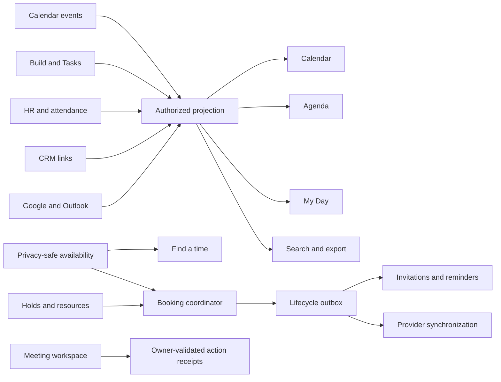

# StreamlineOS Calendar — Technical PRD

**Status:** Canonical technical contract  
**Updated:** 2026-10-20  
**Depends on:** [product-prd.md](./product-prd.md)

This document preserves the implementation constraints formerly spread across architecture, API, audit, evidence, and ticket files.

## 1. Architecture

### Ownership

- Calendar owns native events, occurrences, attendees, RSVP, reminders, availability composition, booking rules, holds, reservations, invitations, and calendar lifecycle events.
- Source modules own source records and mutations.
- External providers own remote copies; Calendar owns local intent, mapping, reconciliation, and visible sync state.
- A displayed action is a capability hint, never authorization to execute. Every read/write rechecks current tenant, membership, module, object, and version.

## 2. Core projection contract

Every projection has:

- `sourceKey`, `sourceRecordId`, and stable `occurrenceId`.
- Safe title and optional deep link after source-owner authorization.
- A typed `entityType`; active meetings, appointments, deadlines, work blocks, absences, milestones, and operational tasks each declare a default `blocksAvailability`. Shift and financial-obligation types remain dormant until their owning-module projections are promoted.
- Discriminated timed-instant or local-date semantics.
- Start/end, authored timezone where applicable, status, availability behavior, and `blocksAvailability`.
- Source version, owner reference when disclosable, permitted actions, freshness state, and as-of time.

Every projection window has:

- Deterministic ordering by effective start plus stable identity.
- `complete`, `nextCursor`, source coverage, source failures, and `asOf`.
- A maximum 120-day request range, 2,000 returned aggregate events, and 400 candidates per source pass. Reaching a cap sets explicit partial/truncation state and a stable continuation or narrower-window path so dense tenants can reach every authorized result.
- A cursor bound to organization, actor/access version, timezone, filters, source set, and ordering version.
- Membership, source-preference, filter, access, or occurrence-order change invalidates the cursor. The server must use a consistent snapshot/watermark or reject it with an honest restart; live pagination must not skip, duplicate, or expose newly restricted rows.
- Independent source failure: one source cannot erase healthy authorized sources.

### Time and recurrence invariants

1. Windows are half-open `[start, end)` in an explicit display timezone.
2. Date-only records preserve their business date and never shift through UTC midnight.
3. Membership uses effective interval overlap, including overnight and multi-day occurrences.
4. A moved occurrence appears once in its effective window, never in its former window, and retains nominal identity.
5. Display, search, export, conflict, availability, and booking use the same occurrence membership algorithm.
6. Expansion/candidate ceilings produce partial or unknown coverage, never free.
7. Invalid recurrence mutations—wrong weekday, beyond end, cancelled occurrence, stale version, or phantom date—write nothing and trigger no reminder or provider effect.
8. Timed writes include resolved instants and an IANA timezone, reject `end <= start`, and declare whether timezone edits preserve the instant or wall time.
9. All-day values use local dates with an exclusive end date. Filtering and rendered grid placement use the selected display timezone consistently.
10. Nonexistent wall times return a typed correction; ambiguous wall times require an explicit fold/offset.

### Native mutation integrity

- The supported RFC 5545 recurrence subset defines normalization, `COUNT`, `UNTIL`, `WKST`, `RDATE`, `EXDATE`, and typed unsupported-rule errors.
- This-occurrence, this-and-following, and whole-series mutations preserve stable occurrence identity and existing exceptions without duplication.
- Native event, series, occurrence, RSVP, reschedule, and cancellation writes require an expected version and return a typed conflict with zero partial side effects when safe merge is impossible.
- Every externally retryable command scopes its idempotency key to tenant, actor, operation, and request hash; identical retries replay the original result, changed input fails, and in-flight state is explicit.
- Occurrence/series cancel, user-visible delete, tombstone suppression, provider cancellation, minimal audit/deduplication retention, and physical erasure are distinct versioned operations.

### Identity and deduplication

- Native/source identity is `(sourceKey, sourceRecordId, occurrenceId)`.
- External identity is `(connectionId, providerEventId)`.
- Native/external copies deduplicate only through an explicit replica mapping.
- Similar title/time is never proof of identity.

## 3. Source adapters

- **Calendar-native:** bounded one-off and recurring candidates, occurrence-ordered before limits.
- **Build:** authorized due dates/milestones, storage ordering before limit, explicit date semantics; project viewers, locked projects, and denied standings never receive an edit capability.
- **Tasks:** storage-level filtering/limits; templates excluded.
- **HR:** leave, holidays, interviews, approved WFH, and attendance through registered projection sources.
- **Attendance:** complete daily aggregation for multiple sessions; errors and partial months remain visible.
- **CRM:** Calendar-native meetings linked to authorized deal/lead records; no duplicate CRM calendar source is required for the current release.
- **External:** independently page every Google/Outlook connection until exhausted or request budget; keep per-account failures and completeness.

`/calendar/events` is the only production projection feed. Frontend-only attendance merging and the unused `/hr/calendar` path must be removed.

## 4. Availability and Find a time

Availability is a minimized service, not a filtered copy of event details.

Inputs:

- Required/optional internal participants.
- Candidate slots or bounded suggestion range and duration.
- Working hours, timezone, approved leave, buffers, host eligibility, connected accounts, source completeness, and resource constraints where requested.

Outputs:

- `free`, `busy`, `tentative`, or `unknown`.
- Coverage state: complete, partial, failed, disconnected, stale, or permission-limited.
- As-of timestamp and privacy-safe explanation.
- Authorized diagnostics may name safe policy/source reasons; guests receive generic reasons only.

Suggestion rules:

1. Generate at most 100 candidates across at most 31 days.
2. Rank complete/free slots first, then safe alternatives; never rank unknown as free.
3. Support alternate duration and no-result explanations.
4. Selection updates a draft only.
5. Event save or booking commit rechecks current facts.
6. Deadline-style projections are nonblocking unless their declared type explicitly overrides that default.
7. Completeness identifies required blocking sources, freshness thresholds, watermarks, and allowed cross-source skew. An unrelated nonblocking-source failure does not make a slot unavailable.

Working policy:

- Personal working hours/location are versioned with organization-default fallback, explicit timezone, and split/overnight windows.
- Working location is informational unless an explicit resource-location policy applies.
- Find a time and booking consume the same effective policy version.

## 5. Booking and resources

### Booking rule

A versioned rule contains host, duration, slot interval, working windows, notice, maximum advance, buffers, daily limit, intake, cancellation/reschedule policy, status, expiry, and required resources.

Existing bookings retain the rule version used at commit.

### Hold

A hold contains owner/session identity, rule version, target slot, constrained people/resources, expiry, fencing token, and idempotency identity.

- Expired, cancelled, abandoned, or crashed holds release capacity.
- Same idempotency key returns the same hold.
- Indivisible capacity has at most one winner.

### Commit

The coordinator rechecks rule/access/version, availability, hold, host eligibility, provider freshness, resources, and capacity inside the commit path.

Receipts distinguish confirmed, rejected, expired, cancelled, pending, and uncertain. Every non-confirmation receipt provides safe alternatives or an explicit recovery path. Local confirmation, provider synchronization, and delivery are distinct visible states.

Public booking and receipt access:

- Public identifiers are non-enumerable, expiring, purpose-bound, and revocable; rate/spam controls and operator-visible abuse state protect availability.
- A consumed booking link alone cannot disclose a receipt. A returning guest uses verified identity or a short-lived `HttpOnly`, `Secure`, purpose-bound completed-session credential for read-only receipt access.
- Revocation or policy changes block new commits without rewriting existing bookings.
- Guest verification challenges are expiring, single-use, attempt-limited, enumeration-safe, and session-rotating. Normalized identity, resend limits, intake size/content limits, and layered link/IP/identity/tenant limits are enforced.

### Resources

- Calendar-managed rooms and source-owned equipment expose minimized availability.
- Maintenance, location, accessibility, and integer room/equipment quantity or capacity affect offered slots; fractional/divisible equipment remains deferred with the Capacity map.
- Resource owners revalidate eligibility and return committed, rejected, or pending receipts.
- A failed or pending required allocation cannot appear fully confirmed.
- Tentative holds/proposals are visually distinct from confirmed allocations.
- Rescheduling or assignment changes revalidate through the owning resource and return a new owner receipt.
- Multi-resource allocation fences expired holds, compensates completed claims after partial failure, reconciles uncertain owner outcomes before retry, releases orphan claims, and rechecks approval/maintenance immediately before commit.

## 6. Invitations and reminders

- Required and optional attendees receive one current invitation.
- Internal users RSVP through identity; guests use expiring, purpose-bound signed links.
- Removed guests and cancelled occurrences cannot use obsolete RSVP/join links, conference metadata, dial-in details, or stale provider join identifiers.
- Reschedule/cancel updates current attendees and suppresses obsolete reminders.
- Defaults, channels, quiet hours, snooze, missed-delivery recovery, and per-occurrence/recipient deduplication are enforced.
- Delivery renders in recipient locale/timezone, handles quiet-hour DST boundaries, atomically supersedes obsolete jobs, processes bounce/complaint/unsubscribe state, minimizes content, and rechecks attendee status and permission immediately before send.
- Organizer departure, email change, late RSVP, cancellation during send, duplicate delivery, and no-show remain covered.

## 7. Google and Outlook reconciliation

- Provider operations cover create, update, occurrence change, cancellation, and conference link.
- Unsupported capabilities fail visibly.
- Inbound provider push/webhook notifications are change hints only; an authorized fetch and reconciliation establishes projection, availability, and sync truth.
- Accept-then-timeout reconciles by stable external identity without duplication.
- Webhooks are version checked, duplicate tolerant, out-of-order safe, and replayable.
- OAuth expiry, invalid incremental token, divergence, and conference failure have repair paths. An invalid incremental token clears unsafe continuation state and performs an authorized bounded full resync without duplicating remote events.
- Simultaneous local/provider edits, remote deletion/tombstones, organizer changes, recurring-instance remapping, subscription expiry, quotas, and backoff reconcile deterministically without overwriting newer intent or resurrecting deleted events.
- Release proof requires real sandbox create/update/occurrence/cancel/reconnect/timeout/duplicate-webhook journeys for both providers.

## 8. Source-linked actions and meeting workspace

Calendar never directly changes source-owned dates.

A proposal records actor, source identity, expected version, intended effect, safe preview, and expiry without writing. On confirmation, the owner reauthorizes and returns committed, failed, declined, or uncertain. Build, CRM, Tasks, and HR adapters keep source-module permission, lifecycle, and version authority for the active release; Inventory and Finance apply adapters remain dormant until Product PRD §3.3 promotion. Apply is a durable idempotent state machine; uncertain outcomes reconcile by owner receipt before retry and duplicate confirmation returns the same receipt without repeating the source mutation. Partial completion exposes repair; it never claims cross-module atomicity.

Meeting workspace:

- Aggregates agenda, notes, files, and currently permitted CRM/Build/document/mail/chat/recording/transcript context.
- Enforces consent, retention, permission revocation, freshness, and partial-source states.
- External guests see only explicitly shared content.
- Generated decisions/follow-ups are drafts.
- Applied actions retain source link, owner, and receipt.

## 9. CRM meeting migration

- New deal and lead meetings are Calendar events with `linkedDealId` or `linkedLeadId`.
- CRM “Schedule in Calendar” deep-links a prefilled draft.
- Deal meeting reads combine linked Calendar events with legacy `deal_meetings`.
- Lead meeting reads use Calendar-linked events plus any existing CRM-owned legacy activity; no new parallel lead meeting store is introduced.
- Existing legacy rows remain readable/manageable; no destructive migration is required.
- New frontend flows stop writing `deal_meetings`.
- Source-owner authorization protects linked title, detail, search, export, notification, and AI context.

## 10. Lifecycle and notifications

Committed event/booking changes emit a tenant-scoped, minimized, versioned outbox record atomically with local state.

Consumers:

- Detect duplicates, gaps, and out-of-order versions.
- Use stable effect idempotency.
- Recheck current permission, consent, and policy at execution.
- Provide retry, dead-letter, replay, and operator repair.

Lifecycle states include confirmed, changed, rescheduled, cancelled, no-show, started, ended, failed, and repaired.

## 11. Frontend contract

The primary UI exposes:

- Modes: Calendar, Agenda, My Day.
- Date navigation and Day/Week/Month.
- One Calendars control for canonical sources and connected accounts.
- Search in Agenda/My Day.
- Global Create action, basic Booking pages, and Calendar settings.
- Event detail actions: RSVP/join, edit/cancel, export, open source, meeting workspace.

It does not expose History, saved-view authoring, capacity, coaching, scenarios, protected work, Radar/chain, payment, workflow, developer, or advanced analytics controls. Any share, toolbar, overflow, or command action without a complete authorized handler is removed rather than left as a dead control.

`calendar-view.tsx` must be split into focused orchestration, surface, state/banner, and overlay modules; no replacement state library or duplicate data path is introduced.

Calendar, Agenda, My Day, command search, and offline snapshots consume one canonical `/calendar/events`/search contract. Production UI must not merge a second external-provider or attendance feed. Partial primary windows provide stable continuation or an explicit narrower-window path rather than a retry-only dead end.

## 12. Dormant backend contracts

This section is the single deferred acceptance owner. These are preservation-only contracts for this release; they cannot add Calendar UI or primary settings without Product PRD promotion. Existing deployed compatibility may remain for:

- **Saved views:** personal/team definitions preserve date logic, source, owner, project, location, status, and view mode; sharing never widens source access.
- **Polls:** required/optional voters use expiring signed voting and holds; finalize rechecks current availability and emits exactly one committed invitation.
- **Team routing:** versioned rules exclude inactive, offboarded, on-leave, over-limit, disconnected, or otherwise ineligible hosts; authorized users receive safe selection reasons while guests receive generic reasons; fairness updates transactionally with booking and an idempotent retry retains the same assignment; CRM ownership, territory, skill, language, collective mode, and safe fallback remain supported.
- **Advanced distribution/embed:** approved branding, localization, WCAG-aligned access, and minimal intake; allowed origins and signed state/callbacks expose only permitted booking facts; single-use expiring links are non-enumerable and replay-resistant; rate/spam controls, revocation, operator visibility, and single-outcome conversion attribution cover refresh, retry, embed, and reschedule.
- **Payments:** payment and booking share one idempotency identity but expose separate states; retries create neither duplicate charge nor booking; failed booking after payment enters repair/refund; failed or uncertain payment never appears paid/confirmed.
- **Workflow builder:** triggers include create, reschedule, cancel, no-show, start, end, and source-state change; execution rechecks conditions, recipients, channels, consent, tenant quiet-hour start/end/timezone, dry run, limits, and policy; quiet hours apply configured delay-or-skip and delay does not consume a retry attempt; effects are once per applicable version with durable retry, dead-letter, replay, and operator repair.
- **Advanced analytics/admin:** metrics derive from lifecycle events and disclose definition, denominator, timezone, deduplication, corrections, and partial-source coverage; a durable aggregate-version watermark survives retention pruning so late/out-of-order versions cannot regress state; privacy facts use a keyed pseudonymous subject, thresholds count distinct people rather than bookings, and subjectless facts never satisfy a cohort threshold; small cohorts and restricted HR/Finance/private inputs cannot reveal individuals; policy covers public domains/links, provider scope, retention, export, automation limits, and abuse controls.
- **Protected work:** only Calendar-managed movable blocks may change automatically; locked blocks, breaks, leave, nonworking days, load, priority, estimates, deadlines, move budgets, and hysteresis apply; every move explains its evidence, prior slot, and version-checked undo; source-owned dates remain proposals requiring explicit owner confirmation.
- **Radar/chain:** dependency edges are explicit, typed, versioned, owner-attributed, and evidence-backed rather than title-matched; cycles, missing/deleted nodes, stale versions, and hidden nodes have safe diagnostics; health is healthy/at-risk/unknown with freshness and coverage; unauthorized nodes use non-revealing placeholders and cannot be inferred through scores/counts; authorized nodes open their source and identify who can act before the commitment slips.
- **What-if scenarios:** one versioned permission-scoped graph snapshot drives a zero-write preview; explicit before/after impact identifies people, commitments, resources, customers, and evidence confidence; the scenario expires on relevant version/access/policy/availability change and reauthorizes each selected owner with per-step outcomes.
- **Capacity map:** partial-day shifts, skills, divisible equipment, location, maintenance, approvals, and tentative claims; explanations reveal only inspectable constraints; tentative state is distinct; reschedule uses `CalendarBookingRescheduleService` with host/org-admin authority, hold/claim shift, resource revalidation, Inventory equipment claim move, and per-resource receipts; capacity lists only reschedulable bookings.
- **Time coach:** opt-in insights define meeting load, protected time, missed commitments, reschedules, and source coverage; recommendations are evidence-backed proposals; private titles and restricted HR/Finance facts stay out of insight/admin aggregates; no employee ranking; small cohorts, outages, duplicates, late events, and changed consent are explicit.
- **Offline cache:** show cache age, last successful coverage, and source staleness; known membership revocation removes sensitive detail; booking, availability confirmation, provider writes, and source-owner actions never claim offline success; reconnect rechecks tenant, membership, object access, source version, availability, and policy before confirmation; changed policy version or disabled policy forces intent review and cannot silently replay.
- **Additional module projections/actions:** future Inventory and Finance commitments retain source ownership, typed availability behavior, permission-safe summaries/actions, deep links, freshness, non-revealing denial, and dormant owner-apply adapter compatibility.

Dormant developer API contract:

- Stable base `/v1/calendar`; `X-API-Key` tenant credentials and user-delegated grants use documented least-privilege scopes. Tenant keys are hashed, expire within 90 days, revoke immediately, and derive tenant identity from the credential record.
- Scopes remain `calendar:availability:read`, `calendar:bookings:read`, `calendar:bookings:write`, `calendar:lifecycle:write`, and `calendar:embeds:read`. Admin credential management stays at `/calendar/admin/developer/credentials`; a secret is returned once with response compression disabled.
- Credential create/revoke requires `Idempotency-Key`. Same-key successful create cannot reveal the secret again and returns `409 CALENDAR_CREDENTIAL_SECRET_UNAVAILABLE`; in-flight identical retry returns `409`; changed actor/input returns `422` and never creates another credential.
- `GET /availability` fences `expectedRuleVersion`, returns at most 100 minimized slots, and uses an opaque cursor. `GET /bookings` omits guest identity, intake, provider payloads, tokens, and routing evidence.
- `POST /bookings` requires booking/session tokens, expected rule version, allowed intake, routing context, consent, and idempotency; it uses the same hold/availability/resource/routing/invitation/commit path as public booking. Same request replays; changed input returns `422`; in-flight duplicate returns `409`; active payment policy is rejected in favor of payment prepare/confirm.
- `POST /bookings/{id}/lifecycle` and versioned `DELETE /bookings/{id}` require lifecycle scope, idempotency, and expected version. Delete is an audited cancellation preserving invitation/provider/refund/webhook history, not physical erasure.
- `GET /embeds/{ruleId}` returns rule/distribution versions, allowed origins, locale, consent policy, and status, never access/session secrets.
- Each credential is limited to 300 requests/minute across Calendar API routes. `429` includes `Retry-After`; missing/expired/revoked/unknown key is `401`; missing scope `403`; wrong tenant `404`; stale/concurrent command `409`; invalid body/cursor `400`. Clients retry only bounded-jitter transient `5xx`, `429`, or in-flight identical `409`, preserving the original idempotency key/body.
- Webhook subscriptions select explicit `calendar.booking.*`, `calendar.event.*`, or `calendar.source.changed` events. Minimized payloads omit guest, intake, payment, meeting, and private-source data and carry delivery ID, API version, event, data, and timestamp.
- Webhook headers are `X-StreamlineOS-Signature`, `X-Webhook-Id`, `X-Webhook-Version`, `X-Webhook-Timestamp`, and `X-Webhook-Event`; signature is `sha256=` plus HMAC-SHA256 of the exact raw body. Receivers compare in constant time, match headers/body, reject timestamps older than five minutes or over one minute future, and atomically claim delivery IDs for the replay window.
- Automatic retries reuse delivery identity/body and retry network/`5xx` failures with bounded backoff; unsafe destinations and `4xx` are terminal; exhausted deliveries dead-letter. Operator replay uses a new signed delivery identity and paginated delivery logs remain inspectable.
- `v1` may add fields but cannot silently change meaning/enums. Breaking paths/webhook versions receive a dated notice with replacement, behavior changes, old credential/subscription cutoff, and shutdown date; the normal minimum is 180 days unless a security exposure requires faster retirement.
- Credential revocation is immediate; webhook deletion cascades its delivery logs; booking deletion remains cancellation; tenant retention/erasure jobs own physical deletion.
- Compatibility, deprecation, deletion, replay, and failed-delivery behavior require focused contract tests before this API is promoted.

No dormant capability may add a visible Calendar control without promotion in the product PRD. Preservation does not override tenant retention, privacy erasure, legal hold, security repair, or removal of proven undeployed/unreachable code after explicit Product decision and dependency proof.

## 13. Security and reliability

- Tenant and object authorization on every derived surface.
- Free/busy is separately minimized.
- Denial never confirms record existence.
- Source/provider reads expose failure, completeness, and freshness.
- Booking/resource uniqueness uses persistence constraints or transactional locking.
- Public tokens are random, hashed where stored, expiring/revocable, purpose-bound, rate-limited, and non-enumerable.
- Public booking exposes rate/spam enforcement, revocation, and minimized operator abuse evidence without leaking internal availability.
- Notification/provider retries are idempotent.
- Audit records identify actor, target, scope, prior/current version, outcome, and timestamp.
- Direct external-event and History reads recheck current membership/object access after provider synchronization or revocation.
- Source deep links allow only validated internal/approved `http(s)` destinations and reject `javascript:`, protocol-relative, and other unsafe schemes.
- Revocation covers attachments, conference secrets, booking intake/receipts, provider mappings, queued payloads, search indexes, and caches. Revoked tokens/cursors fail without confirming record existence.
- Search cursors bind normalized query, authorization version, index watermark, filters, and deterministic rank tie-breakers; permission filtering occurs at query time.
- Persisted caches are actor/organization partitioned, protected at rest, retention bounded, and cleared on sign-out or organization/account switch.

## 14. Accessibility, performance, and locality

- WCAG 2.2 AA pass criterion; keyboard/screen-reader alternatives for grid and drag operations.
- 375/768/1280 responsive journeys.
- Progressive/windowed rendering; no unbounded collection.
- Explicit loading, empty, denied, disabled, partial, stale, and error states.
- First day of week, locale, 12/24-hour clock, and display timezone do not change stored instants.
- ICS export conforms to RFC 5545 recurrence, timezone, and stable identity semantics; iTIP behavior is tested where export or provider delivery uses it.
- Temporal tests cover 23/25-hour days, half-hour offsets, year boundaries, host/guest timezone differences, and timezone-database updates.
- Accessibility proof includes keyboard-only operation, screen-reader grid semantics, virtualization focus, 200%/400% zoom and reflow, forced colors, reduced motion, error recovery, and status announcements.
- Dense representative p95 targets: calendar window under 1.5 s, availability suggestion under 2 s, interaction response under 100 ms excluding network. Evidence states dataset, concurrency, environment, measurement boundary, and error rate.

## 15. Migration, retention, and operations

- HR canonicalization and CRM convergence use expand/contract schemas, resumable idempotent backfills, mixed-version compatibility, reconciliation counts, and rollback that preserves writes accepted after deployment.
- Retention and erasure cover events, occurrences, attendees, intake, notes, attachments, tokens, provider mappings, outbox/audit records, search indexes, caches, analytics, and backups.
- Cancellation, tombstoning, anonymization, legal hold, and physical erasure are distinct states with propagation SLAs and evidence.
- A class-by-class retention matrix records trigger, duration/configuration bounds, legal-hold precedence, erasure authority, provider propagation, backup expiry, and completion SLA before release.
- Initial operations gates: Calendar 5xx below 1% over 15 minutes; provider reconciliation p95 within 5 minutes with alert at 15; oldest ready queue item under 5 minutes with alert at 10; any new dead letter alerts within 5 minutes; RTO at most 60 minutes; RPO at most 5 minutes.
- Source timeout budgets, backpressure, and tested rollback/repair procedures remain explicit even when a partial response satisfies the user request.
- Production module-graph validation makes invitations, required resources, routing, and other active commit dependencies mandatory rather than silently optional.

## 16. Consolidated technical acceptance

These IDs are acceptance contracts, not a second task list. Completion is tracked only by the mapped `CAL-IMP-*` items in the Implementation PRD.

- **CAL-TECH-001 — Projection correctness.** Identity, mutation versioning, time, overlap, recurrence, pagination, coverage, and deduplication invariants pass for every active source.
- **CAL-TECH-002 — Authorization.** Tenant/module/object denial and revocation are proven across range, detail, attachments, conference data, booking intake/receipts, provider mappings, queued payloads, search, export, notification, AI context, caches, and direct URLs.
- **CAL-TECH-003 — Canonical HR data.** HR and attendance flow only through the registered projection; overflow, multi-session, failure, org-switch, and permission-restoration tests pass.
- **CAL-TECH-004 — Availability suggestions.** Bounded ranking, privacy-safe explanations, optional attendees, DST, leave, buffers, stale/disconnected providers, and no-result behavior pass.
- **CAL-TECH-005 — Booking integrity.** Rule version, holds, idempotency, concurrent commit, safe alternatives, secure receipt retrieval, abuse controls, and stale-source blocking pass against real persistence.
- **CAL-TECH-006 — Guest lifecycle.** Invitation, verification, RSVP, obsolete-link/join-information rejection, locale/timezone reminder policy, cancellation, abuse limits, and delivery repair pass.
- **CAL-TECH-007 — Provider reconciliation.** Google and Outlook sandbox matrices, conflict/tombstone handling, invalid-token full resync, and repair paths pass without duplicates or resurrection.
- **CAL-TECH-008 — Resources.** Capacity, maintenance, approval, tentative-state distinction, reschedule revalidation, partial compensation, uncertain repair, and owner receipts pass under races.
- **CAL-TECH-009 — Source-linked outcomes.** Proposals and meeting context reauthorize, require review, reconcile uncertain outcomes, and show idempotent per-owner receipts.
- **CAL-TECH-010 — CRM convergence.** New deal and lead scheduling writes Calendar only while applicable legacy CRM reads remain compatible.
- **CAL-TECH-011 — Focused frontend.** Removed surfaces are unreachable and orphaned frontend code is deleted; primary modes share one data path.
- **CAL-TECH-012 — Release quality.** Type/lint/contracts, real-database suites, responsive browser journeys, WCAG 2.2 AA, migration/rollback, retention/erasure, performance/SLO, and operational evidence pass.
