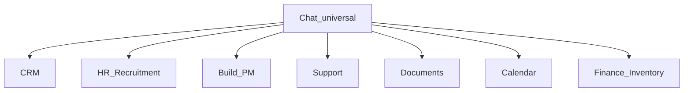

# StreamlineOS Product and Chat Plan

## Coverage recheck

This plan now specifies every original request; it does **not** claim the code is implemented:

- [x] Suite competitor direction for CRM, HRM, product/project work, Docs, Calendar, and Chat.
- [x] Basic, must-have, good-to-have, and wow feature tiers.
- [x] Long-term audiences: startups, product/engineering, sales, HR, mid-market, agencies, and service businesses.
- [x] Chat issue inventory, removals, repairs, safety work, and additions.
- [x] Google connection → Meet and Microsoft connection → Teams through Composio.
- [x] Chat as a universal layer above every module, without module-local messaging clones.
- [x] Migration, compatibility, rollout, measurable release gates, and rollback criteria.
- [ ] Implementation remains pending in the Todo checklist.

## Platform position

Chat is a **universal platform module** (`ladder: "universal"` in [module-manifest.json](../../../frontend/lib/module-manifest.json)). It sits above every operating module:

Rules that follow from that position:

1. **One Chat product.** `/chat` is the org collaboration hub. Module surfaces may embed or deep-link into Chat (for example Build project chat), but they must not invent a second messaging system.
2. **One conversation graph.** A conversation has stable identity wherever it is opened; modules reference that conversation rather than copying messages.
3. **Calendar and identity are shared infrastructure.** Huddles use the same Composio Google/Microsoft connections as Calendar; they do not create a separate OAuth stack.
4. **Not the same as Knowledge Ask Chat or public live chat.** `/knowledge/chat` remains Docs/AI Q&A. `/live-chat/[orgId]` remains public widget/support intake. Those stay out of the universal employee Chat IA.
5. **Always available in the Home shell.** Chat remains a first-class Home destination next to Inbox/Mail/Calendar, independent of which product module is currently selected.
6. **Universal route does not bypass RBAC.** Every active member can reach `/chat`, while reads, mutations, record previews, search, AI, exports, and administration still enforce their exact endpoint and record permissions.
7. **Record linking never grants record access.** Conversation and source-record permissions are intersected at read time; revocation removes previews, snippets, notifications, search hits, AI citations, and exports without deleting the conversation.

Module behavior for this reset:

- **Build:** retain the existing project Chat embed on the canonical Chat backend.
- **CRM, HR, Support, Docs, Calendar, Finance, and Inventory:** preserve permission-safe links/deep links; do not add new module-specific chat screens in this reset.
- **HR, Finance, and sensitive Support records:** never expose titles or snippets to conversation members who lack source-record access.
- **Knowledge Ask Chat, Ask OS, and public live chat:** remain separate products/surfaces and are not merged into employee Chat.

## Target audiences

Long-term markets: startups, product/engineering teams, sales, HR, mid-market companies, agencies, and service businesses.

Launch wedge for suite packaging: **10–100 person agencies and B2B service businesses** running lead → scope/sign → staff → deliver → support → invoice/renew.

Chat itself remains universal for every segment because every segment needs DMs, channels, threads, search, and Meet/Teams huddles on top of their module work.

## Native Chat strategy and reset scope

StreamlineOS owns **native contextual messaging** because conversations attached to customers, work, people, documents, and operational records are part of its differentiating record graph. It does not build video, email hosting, or office infrastructure.

This release is not yet a claim that StreamlineOS fully replaces Slack or Teams. Replacement parity additionally requires governed guests, retention/legal hold, audit export, administration, imports, message recovery/history, and dependable mobile notifications. Those remain post-reset GA blockers unless already proven.

In scope now:

- Message reliability and unread consistency.
- URL/deep-link correctness and bounded exact-message retrieval.
- One search/create/shell model.
- Safe lifecycle actions and accessible interaction.
- Sidebar/details/composer/action-bar simplification.
- Meet/Teams provider selection, provider identity, reconciliation, and Huddle security.
- Backward-compatible redirects, telemetry, rollout, and tests.

Deferred behind adoption evidence:

- New CRM/HR/Support/Finance/Inventory Chat embeds.
- Transcript/recording ingestion, AI meeting notes, expanded entity-action frameworks, and new notification matrices.

## Product decisions

- Use the staged [suite competitor analysis](../knowledge-base/2026-10-20-streamlineos-suite-competitor-analysis.md) as research input, not an unqualified authority. This plan explicitly supersedes its generic “integrate chat” recommendation for **native record-aware messaging**, while retaining its “integrate conferencing” decision.
- Add a focused [Chat product contract](00-chat-product-contract.md) covering Slack, Teams, Google Meet, Microsoft Graph/Teams, the repository audit, and the decisions in this plan.
- Suite feature tiers:
  - **Basic:** shared identity/RBAC, activity and audit, global search/notifications, imports/exports/API/webhooks; CRM accounts/contacts/deals/activities; employee directory/org/onboarding/leave; projects/tasks/milestones/dependencies/templates; Docs/comments/versions/sharing; two-way calendar/time zones; chat DMs/channels/threads/mentions/files.
  - **Must-have:** canonical links across customer/employee/work/content records; lead-to-delivery, hire-to-productive, and support-to-resolution workflows; reliable approvals/automation with retries and logs; client/guest access; Google/Microsoft integration; scheduling and Meet/Teams creation; delivery capacity/utilization/margin; permission-safe search/AI; tenant export, observability, backup/recovery; and consistent denied/error/offline states.
  - **Good-to-have:** governed custom fields/objects/views, portals, goals/portfolios/resource forecasting, accounting/payroll/e-sign connectors, mobile/offline workflows, SAML/SCIM/SIEM/retention, marketplace connectors, and contextual project/account chat.
  - **Wow:** handoff autopilot from won deal to staffed project; cited cross-module operating answers; proactive delivery/margin/renewal risk; daily exception-first briefings; safe natural-language automation with simulation/approval/rollback; scenario planning; organizational memory; and change-impact previews.
- Explicit suite anti-features: no native video/media stack, email host, office-file clone, uncited autonomous AI, duplicated per-module identities/files/permissions, generic dashboard factory, or more top-level routes merely to claim parity.

## Chat feature tiers

### Basic

- Org-wide DMs, public/private/group channels, membership, presence.
- Message timeline, composer, attachments, mentions, reactions, threads.
- Notifications, mute preferences, unread/inbox filters.
- Unified search for messages, channels, and people.
- Realtime delivery, offline queue, deep links.

### Must-have

- Reliable `?channel=` / `?message=` navigation including back/forward.
- One create path and one search path.
- Safe destructive confirmations for delete, leave, archive/hide, and member removal.
- Keyboard and touch-accessible message actions.
- Provider-backed Huddles: primary connected Google account → Google Meet; primary connected Microsoft account → Teams; actionable connect/reconnect UX.
- Project/module embeds that reuse the same Chat backend and permissions.
- Permission-safe denial, empty, loading, and error states via PageState patterns.
- Unread/read-marker consistency, delivery recovery, message edit/delete audit, and no lost or duplicated messages across reconnects.
- Permission-safe “start/open conversation from this record” links without granting access to the record.

### Good-to-have

- Saved messages, pins, shared files, and conversation summarization behind correctly scoped details/overflow surfaces.
- Forward message, invite links, archived conversation recovery.
- Cross-module entity actions from a message (convert to task, assign ticket, set due date) only when the user has that module permission and context.
- Conversation notification preference matrix.
- Governed external/client channels, expiry/revocation, retention, exports, and enterprise administration; these become GA blockers before claiming Slack/Teams replacement.

### Wow

- Permission-safe cross-module reasoning over the commitment-to-outcome graph with current, openable evidence.
- Reviewable actions that resolve a cross-module exception from the conversation with authority preview, approval, audit, and rollback.
- Proactive, cited risk detection that connects customer commitments, delivery, staffing, support, and financial outcomes.

## Chat product boundary

- **Retain:** DMs, private/public/group conversations, threads, mentions, reactions, attachments, pins, notifications, realtime/offline delivery, deep links, project-linked Chat, invitation join flow, and external Meet/Teams join actions.
- **Sidebar target:** Starred plus one Conversations list; URL-backed All/Unread/DMs/Channels filters; Archive as a secondary destination. Remove four competing accordion taxonomies and the compact duplicate action rail.
- **One search:** one unified dialog for messages, channels, and people. Message results load the exact authorized context; people create/open a DM; selecting a non-member public channel joins it before opening.
- **One create owner:** multiple triggers may open one New DM/Channel dialog instance; home, sidebar, mobile, and quick-create must not mount competing copies.
- **Message actions:** Reply opens the thread; React stays primary; More contains save, pin, copy, link, forward, edit, delete, and permission-gated entity actions.
- **Correct scopes:** conversation Details owns members, pins, shared files, and notification settings. Saved messages are user-global and must jump to the exact message. AI summarize belongs in conversation overflow.
- **Remove:** collapsible header chrome that hides primary controls, sidebar search scopes, exposed markdown button strip, hover-only delete submenu, manual “load older” controls, spoofable ephemeral Huddle chat, and dead/orphaned wiring after callers migrate.
- **Do not merge into Chat:** Knowledge Ask Chat and public live-chat widget.

## Huddle provider policy

- **Current state:** Google-only Huddle creation. Teams support, provider fields, and generic UI are target-state work.
- Resolve eligible `googlecalendar` and `outlook` connections across both toolkits rather than calling the current single-toolkit resolver unchanged.
- Selection order: active user-scoped connections before active org-scoped connections; within that scope sort by `isPrimary`, then `createdAt`, then stable ID. If both toolkits are marked primary, this deterministic ordering decides and is logged.
- Never silently fall back to another provider after the selected connection fails. Surface an explicit alternate-provider action in a later iteration.
- Google Calendar creates Google Meet and must return both provider event identity and a join URL.
- Outlook creates **Teams for Business** after capability preflight. Skype-only or conference-disabled calendars are unsupported for Huddles and return 412; do not reuse Calendar’s plain-event fallback.
- No usable account → actionable 412 that opens Calendar accounts.
- Auth/reconnect problems → 412 with reconnect copy.
- Provider/Composio outages → retryable 503. A temporarily pending Teams join URL gets a bounded poll/reconciliation path; a successful Huddle response never lacks a usable join URL.
- No native in-app media stack; join opens the provider URL.
- The selected connection owner is the provider organizer. Provider tenant policy controls external guests, meeting chat, recording, and transcripts; this reset does not promise or ingest those artifacts.
- Persist nullable `meetingProvider`, provider event ID, and integration connection ID. Legacy rows with only a URL remain valid and render as “External meeting.”
- Link the internal calendar event to the external provider identity. End/cancel reconciliation updates the provider event where supported; UI must not claim it ended the external call unless the provider confirms it.
- Make start idempotent. Concurrent starts yield one active Huddle; a race loser’s provider event is durably cleaned up or reconciled. Add a database uniqueness guarantee for one active Huddle per org/channel.
- Move Ably fan-out and notifications after commit; do not hold tenant transactions over provider/network calls.
- Invitations validate active organization and channel membership server-side. Heartbeats require an active Huddle, active membership, and an open participant row.
- Remove “kick from meeting” because current kick only changes StreamlineOS state. If the Streamline roster remains, label it “Joined through StreamlineOS,” not provider attendance.
- Do not market a two-person provider attendance cap: Meet/Teams links bypass it. Gate Huddle creation/group invitation through one backend entitlement source instead of duplicating a false room-cap constant in the UI.
- Audit provider selection, start, join, invite, leave/end, cleanup, and failures without logging tokens or join URLs.

## Chat URL and compatibility contract

- `channel`: selected conversation; derive UI from the URL rather than mirroring it in an effect.
- `message`: exact message anchor; valid only with its authorized channel and cleared when the channel changes.
- `inbox`: All/Unread/DMs/Channels filter and remains URL-backed.
- `dm=1` and `joinHuddle=1`: action parameters consumed once, then removed without losing the remaining state.
- User conversation selection creates history; transient panel/filter updates replace history. Mobile Back clears or restores the conversation URL predictably.
- Exact-message opening uses a bounded, permission-checked message-context endpoint or equivalent cache hydration. It must work when the message is outside loaded pages.
- `/chat/channels` transitions to the unified channel-search state through a documented redirect/deprecation window; existing channel, invite, and message links continue working.

## Implementation

1. Create [00-chat-product-contract.md](00-chat-product-contract.md) with current-state evidence, native-chat rationale, release scope, IA, provider policy, feature tiers, anti-features, metrics, and acceptance criteria.
2. Implement the provider/data contract in the nested backend repository:
   - Add nullable provider, provider-event, and integration-connection identity to [chat-huddle-tables.ts](../../../backend/src/db/schema/chat/chat-huddle-tables.ts), plus one-active-Huddle uniqueness. Register migration journal/rollback and preserve legacy rows.
   - Add a cross-toolkit resolver and Google/Teams mint dispatch in [chat-huddle-meeting.ts](../../../backend/src/modules/chat/chat-huddle-meeting.ts), reusing Outlook capability preflight but rejecting no-conference fallback.
   - Make [chat-huddle-start.ts](../../../backend/src/modules/chat/chat-huddle-start.ts) idempotent, reconcile race-loser events, link the internal calendar row, and fan out only after commit.
   - Tighten invite, heartbeat, join/leave/end, entitlement, audit, and tenant rules; remove provider-misleading kick behavior.
   - Update wire keys, OpenAPI, generated contracts, strict frontend Zod, and [types/chat.ts](../../../frontend/types/chat.ts) additively; `meetingProvider: null` remains supported.
3. Repair message reliability, navigation, and search:
   - Baseline and fix send/retry, offline queue, realtime reconnect, read-marker, and unread-count behavior before declaring the reset stable.
   - Derive selected conversation/message from the full URL contract in [chat-home-page.tsx](../../../frontend/features/chat/chat-home-page.tsx), including history and mobile Back.
   - Add a bounded authorized message-context read so old search/copy links load before scrolling.
   - Unify message/channel/people search; join public channels before open and create/reuse DMs for people.
   - Simplify [channel-sidebar.tsx](../../../frontend/features/chat/channel-sidebar.tsx), consolidate dialog ownership, unify ChatShell, and redirect legacy `/chat/channels` to unified search.
4. Simplify and harden UI:
   - Gate the hub with PageState and a layout-matching skeleton.
   - Implement Reply/React/More in [chat-message-actions.tsx](../../../frontend/features/chat/chat-message-actions.tsx); confirm destructive/lifecycle actions with `ConfirmDialog destructive`.
   - Consolidate details by scope, label composers, remove exposed formatting chrome, and replace visible older-message/reply controls with infinite loading.
5. Secure Huddles:
   - Remove [huddle-chat-panel.tsx](../../../frontend/features/chat/huddle-chat-panel.tsx) and client Huddle publish rights in [ably.service.ts](../../../backend/src/modules/realtime/ably.service.ts).
   - Render provider-aware join/connect/reconnect states; remove false provider attendance, kick, end, and participant-cap claims.
6. Preserve the universal boundary: keep the Build embed on canonical Chat; add no module-local chat clones; enforce record/conversation permission intersections; keep Knowledge Ask Chat, Ask OS, and public live chat separate.
7. Roll out: baseline telemetry → additive contracts/migration → internal cohort → agency/service pilots → staged release → GA. Preserve legacy links, publish support notes for removed controls, and define rollback thresholds.

## Todo checklist

- [x] **CHAT-001** — Write and approve the Chat product contract and baseline telemetry. Approved 2026-10-21; the baseline was taken after release and accepted.
- [x] **CHAT-002** — Add provider/event/connection fields, active-Huddle uniqueness, migration journal, rollback, and legacy-null handling.
- [x] **CHAT-003** — Implement deterministic cross-toolkit Composio selection.
- [x] **CHAT-004** — Mint Google Meet and Teams-for-Business links with correct 412/503/pending behavior.
- [x] **CHAT-005** — Make Huddle start idempotent and reconcile concurrent orphan provider events.
- [x] **CHAT-006** — Link provider and internal calendar lifecycle; move fan-out after commit.
- [x] **CHAT-007** — Extend backend/OpenAPI/frontend contracts additively and regenerate parity artifacts.
- [x] **CHAT-008** — Validate Huddle invites/heartbeats/lifecycle/entitlements/audits server-side.
- [x] **CHAT-009** — Close send/offline/realtime/read-marker/unread reliability gaps.
- [x] **CHAT-010** — Implement the complete URL/history/mobile-Back contract.
- [x] **CHAT-011** — Add bounded, authorized exact-message context loading.
- [x] **CHAT-012** — Unify search; join public channels and open/create DMs correctly.
- [x] **CHAT-013** — Consolidate New dialogs and simplify sidebar to Starred + Conversations + filters.
- [x] **CHAT-014** — Unify ChatShell and preserve `/chat/channels` through redirect/deprecation.
- [x] **CHAT-015** — Gate `/chat` with PageState and correct loading/denied/error/empty states.
- [x] **CHAT-016** — Reduce message actions to Reply/React/More with permission-gated overflow.
- [x] **CHAT-017** — Add consistent ConfirmDialog lifecycle protection.
- [x] **CHAT-018** — Fix composer labels, formatting chrome, and infinite history loading.
- [x] **CHAT-019** — Consolidate conversation Details and user-global Saved scope.
- [x] **CHAT-020** — Remove ephemeral Huddle chat and client Huddle publish capability.
- [x] **CHAT-021** — Remove misleading provider roster/kick/cap/end claims; add provider-aware UI.
- [x] **CHAT-022** — Enforce cross-module permission intersections and product boundaries.
- [x] **CHAT-023** — Add backend/frontend contract, security, concurrency, accessibility, and regression tests.
- [ ] **CHAT-024** — Run all nested-backend and frontend quality gates plus browser journeys.
- [ ] **CHAT-025** — Execute cohort rollout, verify metrics, document support/rollback, then mark GA.

## Verification

- Backend matrix: Google-only, Outlook-only, both/multiple primaries, user vs org scope, reauth, Teams unsupported/pending, provider outage, idempotent/concurrent start, cleanup, lifecycle, invite/heartbeat validation, tenant isolation, wire parity, and subscribe-only Ably capability.
- Frontend matrix: URL back/forward and all params, unloaded exact-message retrieval, public-channel join, people-to-DM, single dialog ownership, redirect, PageState, destructive confirmations, compact actions, scoped details, provider/legacy copy, and removed Huddle/manual-history UI.
- In `backend/`, run focused Jest/e2e plus typecheck/test typecheck, lint, OpenAPI, migration-discipline/chain/rollback/proof, contract, tenant, idempotency, and Ably gates. Run each required self-test first.
- In `frontend/`, run focused Jest plus type-check, spec typecheck, lint, response-contract/parity/drift, permission, PageState, dead-code, file-size, accessibility, and route-bundle gates.
- Browser-check keyboard, touch, focus, screen reader, offline/reconnect, and layouts at 375/768/1280. Mocked provider tests are mandatory; live Meet/Teams smoke tests run only with approved credentials and never modify `.env`.
- Release gates: ≥99.9% message-send success; p95 send-to-visible <1s when realtime is healthy; zero loss/duplication in reconnect cases; ≥95% known-message search success; ≥99% healthy-provider Huddle creation with p95 <5s and a usable URL; no unreconciled provider event older than 24h; zero unauthorized metadata disclosure; authoritative detail revocation immediately and search/AI propagation within 60s; WCAG 2.2 AA core flows; ≥90% pilot task completion without help.
- Roll back a cohort for cross-tenant/record leakage, message loss/duplication, unusable legacy links, provider cleanup backlog beyond its SLO, or material regression in core task completion.
- Preserve all existing staged Knowledge/Wiki work and the unrelated backend document-extraction changes.
